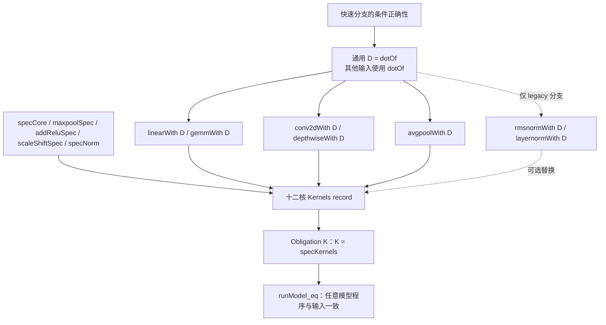

# 不复制旧冠军的最小重建与证明接口图

R24 A；本子任务恢复于 UTC 2026-10-28 21:49:46，交付检查点 22:15，共同截止仍为 2026-10-29 03:38:56。仅核固定源码和数学接口，未写新赛道实现、Lean 文件或 CI。以下 **SOURCE-VERIFIED** 指固定版本文本、导入关系与哈希已经核对；不表示新组合已通过 Lean、gate 或计时。

## 结论与最小构造

不需要 former #2 的 254884 字节实现，便能得到完整十二核的定义正确基线。官方 `kernels/exact/baseline/Kernel.lean` 本身只有 **290 字节**，将提交的 kernel record 取为 `ExactRuntime.specKernels`，正确性是定义等式。本报告没有复制该模板或旧冠军源码；这里只记录接口与固定版本证据。该基线的运行速度不是当前冠军水平，其源码中的历史速度评语不作为本轮成绩。

最小新增目标是一项通用函数等式：令 `D : ExactRuntime.DotFn`，证明

**对所有自然数 n 和所有函数 fa, fb : Nat → UInt32，D n fa fb = ExactRuntime.dotOf n fa fb。**

这里没有“仅合法 tensor”“仅有限浮点”“仅当前 shapes”的隐含前提。有限性、尺寸、位宽或舍入证书只限制 D 的快速分支；不满足时返回原 `dotOf`。有了这项全输入等式，可以让五个模型层直接复用 contract 的遍历、索引、偏置、激活和规格，毋须搬运 #2 的整套逐层证明。

最小阶段可保留整个 `specCore` 和 `specNorm`，只替换 dense 两项、conv 两项、elem 的 avgpool。完整十二核仍然存在。`Layer.apply` 不调用 `K.core.sum` 或 `K.core.dot`；只改 core 不会自动加速这些模型。不能把“有一个正确的 D”写成“所有十二核都会执行 D”。

## ContractExact 的实际公开接口

以下名称属于 `ExactRuntime`，均从允许的单一 `import ContractExact` 可见：

| 接口 | 精确对象、量词或作用 |
|---|---|
| `Word` | `UInt32` 的别名；包括所有原始位模式 |
| `DotFn` | `Nat → (Nat → Word) → (Nat → Word) → Word` |
| `dotOf n fa fb` | 将 fa、fb 的前 n 项各建为长度 n 的数组，再调用 `dotSpec`；任意 n、任意函数均有定义 |
| `CoreKernels` | `sum : Array Word → Word`，`dot : Array Word → Array Word → Word` |
| `DenseKernels` | linear、gemm 两个完整数组到数组函数 |
| `ConvKernels` | conv2d、depthwise，含 `ConvShape`、Bool 激活、输入/权重/偏置数组 |
| `ElementKernels` | avgpool、maxpool、addRelu、scaleShift 四项 |
| `NormKernels` | rmsnorm、layernorm 两项，参数包含 rows、n、epsilon 和数组 |
| `Kernels` | 以上五个 family records；各 structure 具有通常的 `.mk` 构造器 |
| `specCore/specDense/specConv/specElem/specNorm` | 每个 family 的原规格 record |
| `specKernels` | 五个原规格 records 的组合 |
| `Obligation K` | 定义为函数 record 的等式 `K = specKernels`，没有 shapes/domain 限制 |
| `CoreObligation` 等五项 | 各自 family record 等于相应 spec record |
| `obligation_of_families` | 对任意 K，五项 family obligation 成立则完整 obligation 成立 |
| `runModel_eq` | 对任意 K、其 obligation、任意 layers、samples、size、输入数组 x，两个模型执行结果相等；没有另加 shape-valid 假设 |

没有在固定 `ContractExact.lean` 找到名为 `withDot` 的总构造器。实际入口是下面各个 `…With`，由调用者填入 record。

| 十二核 | 换 D 的接口与实际效果 | 仍保留的工作/证明 |
|---|---|---|
| sum | 不自动连接；可保持 `sumSpec` | 若新增 adapter，须证明数组读取与 `dotSpec x (replicate size oneW)` 一致 |
| dot | 不自动连接；可保持 `dotSpec` | adapter 必须保留不等长数组的结果；原 `dotSpec` 对此返回 0 |
| linear | `linearWith D rows inW outW relu X W b` | 内积长 inW+1；最后一项是 oneW×bias；外部 act、数组布局不变 |
| gemm | `gemmWith D batch m k n A B` | 每个输出调用长度 k 的 D，原行/列索引与批次布局不变 |
| conv2d | `conv2dWith D s relu inp wts b` | NCHW/OIHW、padding、stride、bias 尾项与 act 不变 |
| depthwise | `depthwiseWith D s relu inp wts b` | 单通道窗口、bias 尾项与 act 不变；其执行忽略 s.cout |
| avgpool | `avgpoolWith D c h w k inp` | D 求精确窗口和；随后原 FloatLib 除法仍执行，不能将两次舍入变一次 |
| maxpool | 无 DotFn 参数 | 保持 `maxpoolSpec`，或另证完整 ordered IEEE maximum 实现 |
| addRelu | 无 DotFn 参数 | 保持 `addReluSpec`，或另证逐元素加法与 act |
| scaleShift | 无 DotFn 参数 | 保持 `scaleShiftSpec`；是一次舍入 FMA，不是 MUL 后 ADD |
| rmsnorm | `rmsnormWith D` 仅改变 legacy 分支 | stableNormDomain 为真时直接调用 `rmsnormStable`，不执行 D |
| layernorm | `layernormWith D` 仅改变 legacy 分支 | 稳定域且 bias 长度/有限性条件成立时直接调用 `layernormStable`，不执行 D |

由 D 的**函数等式**，各 `…With D = …With dotOf` 只是函数 congruence/substitution；五个 family 等式和完整 record 等式可继续组合。这里省掉的是重复布局证明，不是 D 自身的数学正确性证明。

## 不可误用的接口与原始域

文档提到的 `ExactRuntime.guarded_eq` 实际定义在 **ContractExactChecked.lean:43–49**：它对任意类型 α、β、可判定 valid、fast/spec，以及 `∀ x, valid x → fast x = spec x`，证明 guarded 函数等于 spec。但 Checked 文件只导入 ContractExact，**ContractExact 没有反向导入 Checked**。所以它不是本次 single-import 可直接假定使用的名字。自写一个 Bool 成功分支加原规格回退的短分情况证明即可表达同一数学模式；本任务没有编写该实现或证明。

`LinearValid`、`GemmValid`、`ConvValid`、`PoolValid`、`Layer.checked` 也在 Checked 文件。`ExactToolkit.TensorProofs` 又导入 Checked，`ModelProofs` 导入 TensorProofs；它们不是 ContractExact 的导入依赖。不要因源码里存在 `variance_second_moment`、shape lemmas 或 guarded helper，就直接在候选里引用；也不能增加被 policy 禁止的 import。

原 obligation 对所有 Nat 维度、所有长度数组和所有 UInt32 成立。零 stride、零窗口、零尺寸、短数组、额外元素等不能被从量词中删掉；原函数中的 Nat 除法/减法和 `getElem!` 的默认值由原定义决定。保留 `…With` 可以继承这些行为；自写快速遍历必须以真实边界 guard 保护后回原 spec，而不是截短输入或假设部署检查先执行。特殊值的原始 payload/负零处理同样由 `dotOf` 保留。

若使用 ReLU 的“整个区间非正就返回 +0”，新 helper 仅有 **act true 后的等价**，不再有 D=dotOf。它不能进入上述通用 D 运输链；必须单独证明 activated layer 的观察等式。此处最小重建链只使用完整 raw-word dot 等价。

## FixedWord：可直接引用的证明与尚缺的桥

固定导入链已检查：ContractExact → Values → Decode → Congr → Round → FloatLib → Floats → Kernels → FixedWord。31 份 FixedWord `.lean` 文件合计 **338684 字节**，均带 MIT 许可头，全部 Git blob 逐项重新计算匹配，归档与验证见 `CLEAN-FIXEDWORD-SOURCES.json` / `CLEAN-FIXEDWORD-VERIFICATION.json`。这些已固定的库源码无需复制进 256000 字节候选。

归档同时保留固定 revision 的完整 MIT 文本 `FLOATLIB-MIT-LICENSE.txt`。导入 FloatLib 不代表仓库中任意其它文件都可用；例如另一份 Transcendentals interval 框架仍须检查其独立导入链，不能借此追加 import。这里列出的 FixedWord 和已读 Model rounding 接口不依赖该额外框架。

| 直接可见的 API（前缀 `FloatLib.Numerics.FixedWord`） | 已读定理的必要前提/结论 | 使用边界 |
|---|---|---|
| `UInt128`，字段 hi/lo；`UInt128.toNat` | lo.toNat + hi.toNat×2^64；`toNat_lt`、`toNat_ofNat`、`toNat_injective` 已公开 | 无符号 128 位表示，不是 signed128 prefix invariant |
| `uint64_mul_toNat_of_lt` | x.toNat×y.toNat<2^64 ⇒ native UInt64 乘法保持乘积 | 对 24×24 mantissa 应用此律即可；不必为证明使用更贵的完整 mul64 runtime |
| `mul64_toNat` | 任意 UInt64 x,y，`mul64 x y` 的 UInt128 值等于精确乘积 | runtime 是四个 32 位半字分解；API 正确不等于本路径最便宜 |
| `add64_toNat` / `addCarry64_toNat` / `add128_toNat` | 结果低位值 + carry×2^width = 输入之和；addCarry 含传入 carry | 可用于模数归约；丢弃 carry 后仍须自己的 signed/无溢出论证 |
| `UInt128.less_eq_true_iff`、`compare_eq_toNat_compare_toNat` | 与数学无符号 `<`、compare 一致 | 不能当补码有符号比较 |
| `UInt128.sub_toNat` | 需要 y.toNat≤x.toNat | 不直接覆盖补码负数/0−x 的回绕减法 |
| `UInt128.shiftRight_toNat` | 对任意 Nat shift，值等于数学除以 2^shift | runtime 显式处理 0、<64、<128、≥128 |
| `UInt128.shiftLeft_toNat` | shift<128 且移位后值<2^128 | 不能先回绕再据结果小来推前提 |
| `roundShiftRightEven_toNat`（UInt64） | 任意 UInt64、任意 Nat shift，与数学 RNE shift 相等 | 此实现显式处理 64 及更大 shift，避免普通 UInt64 shift 的模 64 语义 |
| `UInt128.roundShiftRightEven_toNat` | 0<shift<64、hi<2^shift、舍入增量仍 fits64 | **不是任意 128→24 位 rounder**；例如需右移 103 位的情形不满足接口 |
| `UInt256.normalizeJam128_toNat` | 将 256 位值压为 128 位 jam，值关系已证明 | 仍需连接最终舍入、符号与目标格式 |
| `UInt256.roundShiftRightEven128_toNat` | 64<shift<128、top limb 和增量 fit128 条件 | 不是全域任意 shift API |
| `addSignedMagnitudes128` 的 dyadic theorem | 两输入 magnitude 非零；同号时和<2^128 | 它用符号+幅值，并将 cancellation 规范成 +0；不替代 dot 的全负零 provenance |

**UInt192 边界：**完整扫描上述 31 个 FixedWord 文件，没有 `UInt192` 标识符；实际提供 UInt128 和 UInt256。这个结论限定到该固定 FixedWord 包，不声称所有 Lean/FloatLib 模块都没有其它表示。三标量 192 位 accumulator 的解释、carry 和符号扩展仍需自证，或把证明侧嵌入 UInt256 后补 192 位范围桥。

建议只在证明侧用 UInt128/UInt256 作为 mathematical view，运行循环仍可选择显式 `(hi,lo)` 标量参数，再证明单步与库运算一致。这样不会为了引用一个 theorem 就强迫运行时创建结构。是否内联、消除构造器或发生 spill 仍须实际普通构建/ASM，本文不替代测量。

## 两端点 rounder 可直接复用，但开销必须测

完整前缀为 `FloatLib.Floats.Formats.BinaryInterchange.Model.NativeBinary32`。

`roundProduct_eq_roundDyadic` 对 **任意** sign : Bool、product/scale : UInt64，在 `scale.toNat ≤ 506` 时，将 `roundProduct sign product scale` 等同于 native dyadic rounder，dyadic 的 mantissa 为 product.toNat，指数为 scale.toNat−298。`ofUInt32_roundDyadic` 再将该原始字连接到 `Model.roundDyadic FloatFormat.binary32`。没有把 product 限定为某一次实际 Float32 乘法的结果。

因此 A 的区间方案取 C=H+L、B=C−14。在 **14≤C≤377** 的保守首版中，scale=B∈[0,363]，端点绝对值<2^63，正好满足库接口。bias 仍按 oneW 的 mantissa 2^23、idx 126 作为完整 product term，并计入 n、L、H。C<14 的初版非零证书本来不会接受，可先回原规格；非正区间 fused ReLU 分支另有自己的语义接口。

但 runtime 非零分支直接调用 **product.log2**，并非固定深度二分 log helper。固定 Lean UInt64.log2 接到 `lean_uint64_log2`；pinned `lean.h:2142–2150` 是 `while(a>=2)` 逐次折半计数。R22 的原始 wrapper 也观察到 loop。本轮新实际 caller 的 ASM 未运行，不能从 `UInt64` 或 `[inline]` 名字断言两个端点很便宜。这个 API 适合作为**证明较轻的第一比较版本**；必要时测完再替换终结器。

## 最小证明依赖与字节决策

| 层级 | 可复用的固定接口 | 新后端必须交付的内容 |
|---|---|---|
| raw word → exact value | `mantOf_lt_24`、`idxOf_le`、`decodeD_toRat` | 实际 guard 产生的有限性/索引/位宽事实 |
| machine accumulation | FixedWord word/carry/shift/value 定理 | 显式状态的前缀不变量、模数→有符号值、truncation/区间误差 |
| integer/dyadic → word | `finishWord_of_ne`/`finishWord_zero`；roundProduct 两条桥 | 目标格式 `Fmt`、端点 scale、符号与 zero guard 的组合 |
| interval acceptance | `roundAt_mono`、有限舍入桥、非零 finite 注入性 | 两端同 magnitude-nonzero raw word ⇒ 本次原 exact dot word；此新组合仍未 Lean 验证 |
| exact finite dot | `finiteDotSlice_eq`、`dotStateLoop_flags`、公开 FloatLib reduction theorems | 实际 callback/read sequence 与数学数组/和的对应；可在证明侧使用 Array.ofFn |
| universal D | 原 `dotOf` fallback | 对失败 guard、NaN/Inf、zero/特殊范围的全输入函数等式 |
| five model layers | 五个 `…With` 定义 | 由 D=dotOf 作 congruence；不重写布局 |
| entire model | family obligations、`obligation_of_families`、`runModel_eq` | 十二字段均指向已证后端或原 specs，原始完整 gate |

字节事实：spec 基线 290B；官方通用 incumbent 38506B；former #2 254884B；上限 256000B。290B 仅是定义正确基线的实存源码大小，不是未来 fast D 的尺寸估计。新算法/证明最终字节数 **UNKNOWN**。引用已导入的定理不需要贴入其 338684B 源码；完全重写 #2 的优化不属于“最小”前置。新 clean 基线可能仍在 stable norm、element kernels 或 fallback 上很慢，不能由“接口闭合”推断可挑战当前冠军。

## 固定证据索引

官方 revision `accb82b6e2adeda1b41a57a260d68fb3879c427e`：ContractExact Git blob `fba2ff6e77cf75922c6819f9193491cb8224459d`，本地 SHA-256 `bddd6bd9caa19f9419e0e38cd553b109a7675fc710fdf82a6d6f7d0f2a4c8b1b`；Checked `0b96dbc42f0f3744af283d0bfd9498a47a3c8b5e`；baseline `641c6f349960ccf6759cc8f7adcd2817d2b219b5`；VerifyExact `55f53e5ea381f94228b027f687f4eec93d766a70`。本地已有官方原件在本轮 `development-broad/torchlean-source/` 与 `source-snapshot/torchlean/`，本任务不复制许可未知的原文。

FloatLib revision `0d91825727839f597fd06b22fdd038ea21480f0c`：FixedWord 31 文件及其 bytes/SHA-256/Git blob 见本目录 verification；Native roundProduct runtime `0281d9e178e431fe5b1dac602ddcb8bffab1b0ab`，proof `a3527b212265369df3a3e1663604a93d65eb1b8f`，Agreement `f319e0d19a7aa8f421a169c0c4f8bf6d2497722a`。这些库文件保留 MIT 头。

三份 Native rounder 原件另存 `CLEAN-ROUND-API-SOURCES.json`，均按源内容重新计算 Git blob 匹配。连同 FixedWord 共 34 份 MIT 原件；不包含 former #2，也不包含许可未知的官方提交模板原文。

Lean revision `293d5d0c0c3f3dded4688b3ccd6a33939ac5102b`：`Init/Data/UInt/Log2.lean` blob `3e793cc247a5fea9331a3218d2bf5317a34efaf4`，`lean.h` blob `910ecae72a7d1c149d4ccc8111ee438c8b4551dd`。这里只据已读定义说明 log2 路径，不开展新的编译器推测或执行。

下一项真正验收仍须等待用户的目标决定：在固定 runner 上用合法单一 import 核验所用名字和新组合，再测实际完整 caller。本文不启动这项工作，也不把 source 可见性、已有库定理或纸面运输称为新包已通过 gate。
