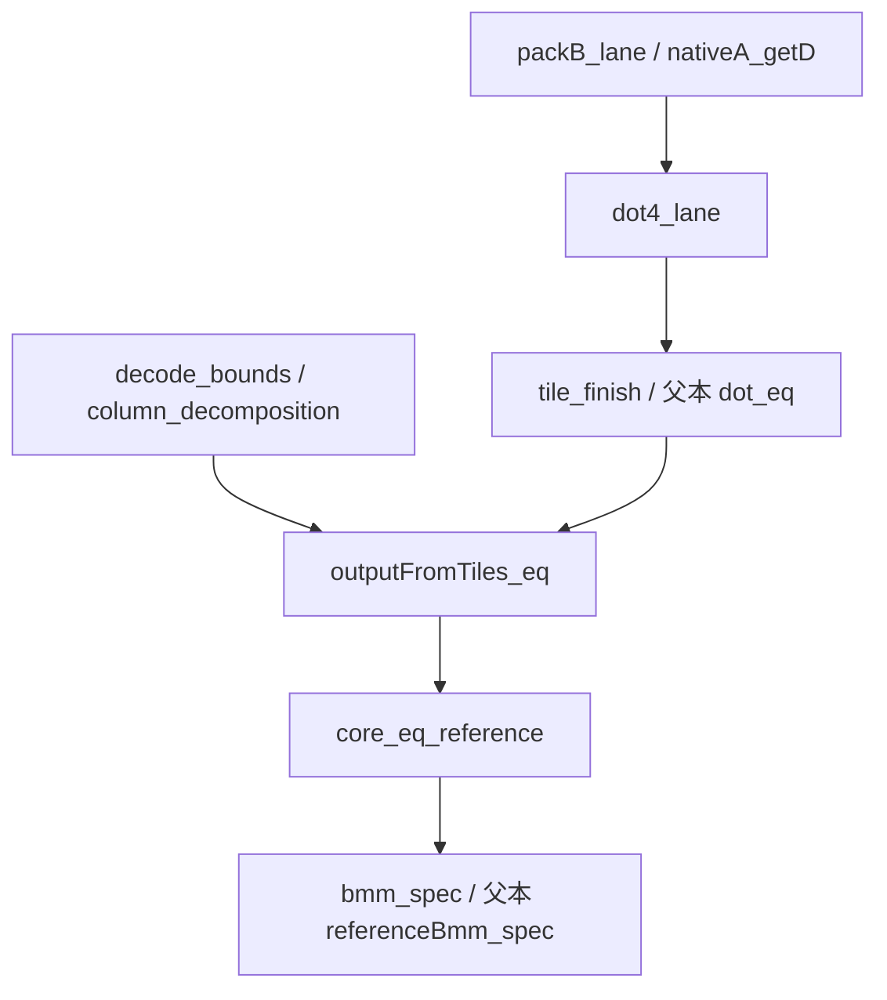

# FloatLib R2-W02b：在公开 final-finite 父本上接齐 Packed4 bmm

交付日期：2026-10-21 UTC。研究范围：只使用本轮用户消息、精确固定的公开父本和公开依赖；未读取旧交付包、私有会话、私有附件或账户。

## 结论与证明状态

本轮交付一份完整的四函数 `Kernel.lean` 编译候选。父本 add、mul、sum、其证明和数值桥原样保留；新 bmm 已写出 `packB` 有效 lane 读取、四路递归投影、最终 guard 与回退、块结果缓存、逐输出元素等式以及无条件 `bmm_spec` 的全部证明体。最终定理只有原始维度与输入向量参数，没有外部 sound 前提，也没有把长度等式当成元素正确性。

**这是源码连接完整、等待固定环境编译验收的候选。当前环境没有 Lean、lake 或 elan；新增证明 elaboration、内核重放、公理输出、原生编译和完整 gate 均为 `NOT_RUN`。** 本轮没有安装工具链，没有执行 C timing，没有修改 benchmark 请求，没有正式提交。静态审阅和符号诊断不能替代 Lean 内核接受。

| 项目 | 本轮结果 | 证据 |
| --- | --- | --- |
| 公开父本精确字节 | 58,079 字节，SHA256 与用户给定值相同 | `parent/Kernel.lean`、`sources/provenance.json` |
| 父本保护区 | 前 56,956 字节逐字节保留 | `diagnostics/source_preflight.json` |
| 完整新候选 | 72,509 字节、1,684 行，小于 256,000 字节 | 同上 |
| import / 词法检查 | 唯一 `import ContractTensor`；固定禁止项扫描包括注释，零命中 | `diagnostics/verify_source.py`、`sources/policy_snapshot.json` |
| 参考环境文件核对 | 12 个固定官方文件 hash 一致 | `sources/required_workspace_hashes.json` |
| 符号布局与操作树诊断 | 1,600 个形状、21,600 个输出表达式树一致；96 个 total-read/default 案例 | `diagnostics/layout_trace_result.json` |
| 四函数完整证明源码 | 已提供；没有证明占位 | `Kernel.lean`、`PROOF_DEPENDENCIES.md` |
| 新候选 Lean / kernel / gate | **NOT_RUN** | `diagnostics/environment.json` |

完整候选 SHA256：

```text
be7f94691e8a93eeb6f6f704869a280714f01d9f0efca21989d3a7b6eb7136a0
```

## 1. 父本核对与变更边界

父本是用户给定的公开 Miner commit `46a9f085db7634a22324d25623f715829f7074f9` 下 `competitions/floatlib/candidates/f01-d2-final-finite/Kernel.lean`。本轮实际下载并读过其定义，文件长度为 58,079 字节，SHA256 为：

```text
86312a3759286cb207f946af9db95546777fdb16f1bd147f7892c0f9e1d79217
```

用户反馈该父本完整 gate `39656662501` 已通过。本包将它记录为 **USER_SUPPLIED_PASSED_NOT_INDEPENDENTLY_ACCESSED**，没有访问 CI，也不把这个结果转记到新候选。[PARENT]

保留区从文件开头到父本 `index_address` 定理结束，共 56,956 字节；其 SHA256 为：

```text
8da4633f590ec59354b3607dd1837eb020b22f6d32c928cd7002e0ba67bbe166
```

新文件替换父本末尾的 bmm 定义与 `bmm_spec`，在原 `Submission` 命名空间中加入 `Packed4` 实现与证明，最后关闭该命名空间。精确差异见 `parent-to-packed4.diff`。可读源码片段位于 `src/`，只是同一文件的分段，不增加 import 或模块依赖。

| 保留部分 | 处理 |
| --- | --- |
| `add`、`add_spec`、相关等价证明 | 原样保留 |
| `mul`、`mul_spec`、相关等价证明 | 原样保留 |
| `sum`、`sum_spec`、`NativeFinal.sumLoop_eq` | 原样保留 |
| `GuardBridge`、`NativeBridge`、`FinalFinite` 数值桥 | 原样保留 |
| `NativeFinal.dotLoop`、`dotLoop_eq`、`dot`、`dot_eq` | 原样保留并复用 |
| `referenceBmm`、`referenceBmm_spec`、`index_address` | 原样保留，作为最终连接目标 |
| 末尾 `bmm` 与 `bmm_spec` | 替换为本轮完整实现及证明 |

父本原有注释或历史性能文字随保护区保留；它们不代表本轮的新测量。新增候选没有新编译选项，诊断命令只放在独立诊断文件中。

## 2. 已实际读取并复用的数值证明

本轮不重新开发 final-finite guard，也不研究另一条 ordered-sum 算法。关键做法是证明新缓存与四路循环在每个有效 lane 上产生**同一个父本原生递归值**，然后复用父本已给出的最终结果桥。[PARENT]

| 已存在的声明 | 作用 | 本轮依赖方式 |
| --- | --- | --- |
| `GuardBridge.finiteRoundtrip` | 原生转换结果 finite 时，将往返转换接回原始 Binary32 | 保留在父本 `dotLoop_eq` 的证明链中 |
| `NativeBridge.ofFloat32Mul` | finite 原生操作数的乘法桥 | 同上 |
| `FinalFinite.add_finite_inputs` | 加法终点 finite 推出相应输入 finite | 父本逆向有限性归纳 |
| `FinalFinite.mul_finite_inputs` | 乘法结果 finite 推出相应输入 finite | 同上 |
| `NativeFinal.dotLoop_eq` | 原生点积的 finite 终点等于指定有序 fold | 被父本 `dot_eq` 使用 |
| `NativeFinal.dot_eq` | 原生终点 guard 与原软件回退的整体等价 | 新 `core_eq_reference` 直接复用 |
| `referenceBmm_spec` | 参考输出向量满足固定的 `bmmSpec` | 新 `bmm_spec` 的最终一步 |

因此新证明的数值部分没有等待外部开发者提供的接口。中间 `hb` 和 `hs` 是局部等式引理参数：`hb` 由真实 `packB_lane` 生成，`hs` 由 `dot4_lane` 生成；它们都在候选内部消去，不出现在最终 `bmm_spec` 的参数中。

需要保持证据边界：上述父本声明已实际存在且已读取；新证明脚本引用它们是否成功 elaboration，仍待 Lean 4.34.0 实际执行。

## 3. 唯一实施机制：分层四字段缓存与四条有序链

令 `G = (p + 3) / 4`。本轮选择一个便于证明、直接可编译尝试的布局：

```lean
nativeA : Array Float32
packedB : Vector (Vector (Vector F4 n) G) batch
tiles   : Vector (Vector (Vector F4 G) m) batch
```

`packedB` 按 `[b][g][k]` 组织；每个元素是四个 `Float32` 字段。`tiles` 按 `[b][i][g]` 保存四路点积结果。非退化调用中，A 整体转换一次，B 每个有效元素转换一次，每个块结果计算一次，之后逐输出选择 lane 并进行终点检查。尾部无效字段填入原生 `+0`。

这个选择用两类额外容器和一次输出遍历，换取直接的 typed cache 读取证明。没有保留第二种布局，也没有扩展 USize 索引优化。

### 3.1 `packB` 的实际构造

以下是候选中的定义，名称解析位于 `Submission.Packed4`：

```lean
def packB (batch n p : Nat) (B : Vector Binary32 (batch * n * p)) :
    Vector (Vector (Vector F4 n) (groups p)) batch :=
  Vector.ofFn fun b =>
    Vector.ofFn fun g =>
      Vector.ofFn fun k =>
        packet (fun j =>
          if j < p then
            ExecFloat.Binary.toFloat32
              (B.toArray.getD ((b.val * n + k.val) * p + j) posZero)
          else zero32) (4 * g.val)
```

`packet` 在 `col`、`col+1`、`col+2`、`col+3` 上调用 `read`；`F4` 含 `s0`、`s1`、`s2`、`s3` 四个 `Float32` 字段。越过最后一列时填 `zero32`，不读取相邻行或相邻 batch 的元素。

### 3.2 k 循环使用四个独立递归参数

```lean
def dot4 (n baseA : Nat) (A : Array Float32) (B : Vector F4 n)
    (k : Nat) (s0 s1 s2 s3 : Float32) : F4 :=
  if hk : k < n then
    let sharedA := A.getD (baseA + k) zero32
    let v := B.get ⟨k, hk⟩
    dot4 n baseA A B (k + 1)
      (s0 + sharedA * v.s0)
      (s1 + sharedA * v.s1)
      (s2 + sharedA * v.s2)
      (s3 + sharedA * v.s3)
  else ⟨s0, s1, s2, s3⟩
termination_by n - k
```

B 的 `[b][g]` 两层选择在进入该循环之前完成；循环内只读取当前 k 的一个 F4 记录。每个有效输出始终沿自己的 `k=0,1,...,n-1` 链前进，表达式是 `s + a * b`。没有将 k 拆成可重结合的局部和，也没有调用 FMA。这里只说明 Lean 源码结构；本轮未生成 C 或检查汇编。

循环状态使用四个独立 `Float32` 参数；返回时才构造结果 F4。B 和结果缓存采用四字段记录。这符合本轮的明确机制，但不把“源级四条链”直接说成“已经 SIMD”。装箱消除、实际字段表示、引用计数、SLP 与寄存器分配都没有在本轮运行验证。

### 3.3 块结果只计算一次

```lean
def tileResults (batch m n p : Nat) (A : Array Float32)
    (B : Vector (Vector (Vector F4 n) (groups p)) batch) :
    Vector (Vector (Vector F4 (groups p)) m) batch :=
  Vector.ofFn fun b =>
    Vector.ofFn fun i =>
      Vector.ofFn fun g =>
        dot4 n ((b.val * m + i.val) * n) A ((B.get b).get g) 0
          zero32 zero32 zero32 zero32
```

最终 `core` 先建立 `nativeA`、`packedB`、`tiles`，再构造 `Vector.ofFn (outputFromTiles ... tiles)`。`outputFromTiles` 只读缓存和执行 `finish`，里面没有 `dot4`。因此源码算法并非让每个输出重新计算四条点积。

Lean/C 编译结果尚未检查；源码级共享设计不等于已经测得具体运行时分配次数。

## 4. 从布局到无条件 bmm_spec 的证明链



图中每个新增节点都有完整证明文本；箭头说明源码依赖，不表示已获得 Lean 编译成功记录。

### 4.1 有效 B lane 的读取值

`packB_get` 三次使用 `vector_get_ofFn`，把三层缓存读取化为构造函数；`lane_packet` 将 lane 读值化为 `read (4*g+l)`；最后由 `hcol` 消掉填充支路。完整目标为：

```lean
theorem packB_lane (batch n p : Nat)
    (B : Vector Binary32 (batch * n * p))
    (b : Fin batch) (g : Fin (groups p)) (k : Fin n) (l : Fin 4)
    (hcol : 4 * g.val + l.val < p) :
    lane ((((packB batch n p B).get b).get g).get k) l =
      ExecFloat.Binary.toFloat32
        (B.toArray.getD
          ((b.val * n + k.val) * p + (4 * g.val + l.val)) posZero) := by
  rw [packB_get, lane_packet, if_pos hcol]
```

这一等式直接说出原始 B 的读取值，未把“缓存长度正确”代替“缓存内容正确”。所用标准库接口已对照 Lean v4.34.0 的 `Vector.get`、`Vector.ofFn` 和 `Vector.getElem_ofFn` 阅读。[VECTOR_BASIC]、[VECTOR_OF_FN]

### 4.2 A 的 total read，包括越界默认值

`nativeA_getD` 对所有 `i : Nat` 证明：

```lean
(Araw.map ExecFloat.Binary.toFloat32).getD i zero32 =
  ExecFloat.Binary.toFloat32 (Araw.getD i posZero)
```

范围内用 `Array.size_map`、`Array.getElem_map`；范围外双方归约到原生正零。此处不是假定一般 Float32 往返转换无损。实际读取的 FloatLib 透明定义链是：

- `toFloat32` 通过 `toBits32` 投影 word，再调用 `Float32.ofBits`；
- `Competition.posZero` 指向 binary32 的 false-sign zero；
- model zero 与 Word32 storage 的透明打包把其位值化为 0。

因此这里只用具体的 `toFloat32 posZero = Float32.ofBits 0`。相关链条与路径逐项记在 `diagnostics/Audit_notes.md`；没有经过 `Float32.toFloat` 或 `Float.toFloat32`。[CONTRACT_TENSOR]、[NATIVE]、[VALUE_CORE]、[MODEL_CARRIER]、[STORAGE_RUNTIME]、[STATIC_STORAGE]

### 4.3 `dot4_lane`：任意起点、任意累加状态的投影

引理对任意 k、四个初始累加器和任意 lane 证明：

```lean
lane (dot4 n baseA (Araw.map ExecFloat.Binary.toFloat32) B
  k s0 s1 s2 s3) l =
NativeFinal.dotLoop n baseA baseB p Araw Braw k
  (lane ⟨s0, s1, s2, s3⟩ l)
```

其局部 `hb` 要求 B 流的这个 lane 在每个 `i : Fin n` 上等于原始 B 的 `getD (baseB+i*p) posZero` 转换值。递归分支只进行三件事：逐 lane 展开同一个 `s+a*b`，用 `nativeA_getD` 替换 A 读取，用 `hb` 替换 B 读取，然后递归到 k+1。终止度量沿用 `n-k`。

这一步没有 finite 前提，也不做浮点代数重结合。它比较相同原生表达式的两种组织，而不是用实数数学等价替代 binary32 位值等价。`tile_finish` 用实际 `packB_lane` 和父本 `index_address` 提供全部 `hb`。

### 4.4 最终 finite 接纳与原始输入回退

实际 `finish` 的有限性支路和回退 fold 与父本 `NativeFinal.dot` 相同：

```lean
def finish (n baseA baseB p : Nat) (Araw Braw : Array Binary32)
    (result : Float32) : Binary32 :=
  if hf : result.isFinite = true then ExecFloat.Binary.ofFloat32 result
  else Fin.foldl n
    (fun a i => Submission.add a
      (Submission.mul (Araw.getD (baseA + i.val) posZero)
        (Braw.getD (baseB + i.val * p) posZero))) posZero
```

`finish_eq_dot` 在 `result = NativeFinal.dotLoop ... 0 zero32` 时把它归约为父本 `NativeFinal.dot`；`finish_dot4_lane` 通过 `dot4_lane` 和 `lane_zero4` 在候选内部提供这个等式。

因此 NaN payload、Inf、次正规数和正负零不需要在新布局证明里各做一个未经证明的“兼容性例外”：新循环与父本循环逐 lane 相等，最终整体等价由父本 `dot_eq` 接回原始 `ExecFloat` fold。非finite分支严格使用原始 A/B 和原样 `Submission.add/mul`，不从已转换或已规范化的 native 缓冲恢复特殊值。[PARENT]

这说明候选证明脚本的覆盖路径；原生特殊值执行仍未运行。

### 4.5 输出构造：长度和每个元素都连接

原 Array push builder 的 `blocksGo/rowsGo` 前缀不变量不再是本候选的证明目标。改用三层 `Vector.ofFn` 保存结果，再用最终 `Vector.ofFn` 构造输出：

1. `decode_bounds` 从任意 `q : Fin (batch*m*p)` 推出解码后的 b、i、j 有界。它自己排除不可能的零分母情形，不要求调用者提供正尺寸条件。
2. `groups_pos_of_col` 证明 `j/4 < groups p`，`column_decomposition` 证明 `4*(j/4)+j%4=j`。
3. `tileResults_get` 把缓存中一个块的读取化为该块唯一的 `dot4`。
4. `tile_finish` 把该块的有效 lane 接到正确 batch、row、column 的父本点积。
5. `outputFromTiles_eq` 对每个合法 q 证明选出的元素等于该 q 的父本点积。
6. `core_eq_reference` 在 `Vector.ofFn` 下对 q 使用函数外延，结合 `NativeFinal.dot_eq` 和原 `index_address`，得到整个向量等于 `referenceBmm`。

长度由 `Vector` 类型与 `Vector.ofFn` 保证；元素正确性由第 4–6 步保证。两者同时存在。`decode_bounds` 使用的 `Nat.div_lt_iff_lt_mul` 和 `Nat.mod_lt` 参数顺序已对照 v4.34.0 源码。[NAT_DIV]

### 4.6 无条件最终定理

候选最终声明保持原合同：

```lean
theorem bmm_spec : ∀ (batch m n p : Nat) (A : Vector Binary32 (batch * m * n))
    (B : Vector Binary32 (batch * n * p)),
    (bmm batch m n p A B).get = bmmSpec batch m n p A.get B.get := by
  intro batch m n p A B
  have h : bmm batch m n p A B = referenceBmm batch m n p A B := by
    unfold bmm
    split
    · rfl
    · split
      · rfl
      · exact Packed4.core_eq_reference batch m n p A B
  exact (congrArg (fun v : Vector Binary32 (batch * m * p) => v.get) h).trans
    (referenceBmm_spec batch m n p A B)
```

上面的两个直接分支分别对应空输出和 n=0；其他尺寸走 Packed4。它没有引入“假设本算法 sound”或“输入全部 finite”等前提。

## 5. 任意维度与特殊值边界

| 情形 | 源码处理 | 证明连接 |
| --- | --- | --- |
| batch=0、m=0 或 p=0 | 输出总长为 0，直接 `referenceBmm`；不建立新 native 缓冲 | 最终 bmm 向量等式的第一个分支 |
| n=0 且输出非空 | 直接 `referenceBmm`，各点积是从 +0 开始的空 fold | 第二个分支与原 `referenceBmm_spec` |
| p 不是 4 的倍数 | `groups p` 向上覆盖；无效字段填 +0；只输出 j<p 对应 lane | `hcol`、列分解和解码界 |
| 尾 lane 遇到 Inf×0 | 允许无效 lane 变成非finite；四条链互不读取对方状态 | `dot4_lane` 的逐 lane 投影；无效 lane 不输出 |
| 越界 total read | A map 保持 getD 的 +0；B 有效 lane 保留原始 getD，尾列显式 +0 | `nativeA_getD`、`packB_lane` |
| 原始 NaN、payload、Inf | 相关 lane 的终点不满足 finite 时，按原始 raw 输入精确重算 | `finish_eq_dot`、父本 `dot_eq` |
| 有限原生终点 | 经同一终点 guard 和父本 finite 桥接回原始 bit-level 结果 | 父本 `dotLoop_eq`、`dot_eq` |
| ±0 与次正规数 | 不跳过零、不重结合；同一乘加顺序、同一 +0 初值 | 原生递归投影与父本 fold 等式 |
| 大 Nat 尺寸 | 新实现全用 Nat/Fin；没有 USize 截断支路或额外机器字长假设 | 原始函数签名与 typed 索引 |

任意数学尺寸的定理不承诺任意大数组都能在有限内存中分配；本轮没有把资源限制改写为合同前提。

## 6. 本轮实际执行了什么

### 6.1 只读来源、保护区和词法检查

`diagnostics/verify_source.py` 实际完成以下检查并保存 JSON 与 stderr：

- 父本长度与 SHA256；新候选长度、行数与 SHA256；
- 父本 56,956 字节前缀与新候选相同；
- 用父本保护区和 `src/` 四段重组的结果与完整 Kernel 完全一致；
- 唯一 import、固定属性/选项约束和包括注释的禁止项扫描；
- 12 个固定官方文件 hash，以及从官方 gate 源码 AST 读出的词法规则与快照一致。

该脚本不执行 gate 源码、不改官方文件，也不检查 Lean 证明是否成立。原始结果为 `PASSED_SOURCE_AND_LEXICAL_PREFLIGHT`，不是 `PASSED_GATE`。[GATE]

### 6.2 独立的符号布局诊断

`check_layout_trace.py` 使用完全符号化的输入值，构建有序表达式树 `add32(acc,mul32(a,b))`。它比较逐输出参考算法与本轮缓存、四路块、lane 选择的结构，并检查每个块只计算一次。

实际遍历 batch=0..3、m=0..4、n=0..7、p=0..9，共 1,600 个形状，比较 21,600 个输出表达式树；模型执行 6,300 次四路块调用。另外检查 96 个 map/getD 默认值案例。结果保存为 `PASSED_SYMBOLIC_SCHEDULING_MODEL_ONLY`。

这个诊断能帮助发现缓存地址、尾块选择、输出顺序和重复计算等错误，但没有执行 Lean，也没有执行原生 Float32。它不覆盖实际 NaN payload 处理、C 生成或引用计数，不能作为全输入位等价的证明替代。

### 6.3 未运行项目与当前停止点

| 验收项目 | 状态 |
| --- | --- |
| 新 Kernel 的 Lean elaboration | NOT_RUN |
| 四个 obligation 的 VerifyFull 构建 | NOT_RUN |
| leanchecker 内核重放 | NOT_RUN |
| 新最终定理的公理集合输出 | NOT_RUN |
| 新原生执行与 raw 特殊值校验 | NOT_RUN |
| 完整官方 gate | NOT_RUN |
| 新 C/汇编检查、时间与内存测量 | NOT_RUN |

环境记录显示 Python 3.12.14、Linux x86_64；PATH 中 lean、lake、elan 均缺失。没有安装工具链。当前没有由 Lean 报出的首个错误或未解目标可供列出，不能虚构错误日志；剩余验收目标是这份完整证明文本在固定环境中的实际接受。

静态独立审阅没有发现已确定的声明名、参数顺序、索引连接或相等式方向阻断。它同样不是编译保证。若实际编译失败，保留真实首个错误与目标，按 `COMPILE_REQUEST.md` 的依赖顺序修复；不通过增加 sound 前提、扩大合同、加入证明占位或改官方环境来消除错误。

## 7. 完整调用费用：这个证明友好布局付出了什么

本节是源码计数，不是运行时计时或实测分配次数。仅沿用固定 `BenchBmm.lean` 的默认形状 batch=2、m=50、n=100、p=50，因此 G=13。[BENCH_BMM]

| 项目 | 默认形状的源码计数 | 解释 |
| --- | ---: | --- |
| A 转换 | 10,000 | A.map 一次 |
| B 有效元素转换 | 10,000 | 每个有效列在唯一包的唯一字段中 |
| 输入转换合计 | 20,000 | 父本逐 MAC 两次转换的次数推导为 1,000,000；这里不是速度结论 |
| B 的 F4 记录 | 2,600 | batch×G×n |
| B 尾部填充字段 | 400 | batch×n×(4G−p)，直接填原生 +0 |
| 结果 F4 记录 | 1,300 | batch×m×G，全部计算并缓存一次 |
| 四路迭代 | 130,000 | batch×m×G×n |
| 原生乘法 / 加法 | 各 520,000 | 包括无效尾 lane；比 500,000 MAC 多 4% |
| 最终 lane 选择与 finite 检查 | 各 5,000 | 只对真实输出执行 |
| 输出阶段缓存读取 | 15,000 次逻辑 Vector.get | 每个输出读取 b、i、g 三层 |

分层缓存的逻辑 Array 容器数也要算进去：

- B 缓存：`1 + batch + batch*G = 29`；
- 结果缓存：`1 + batch + batch*m = 103`；
- 加上 A.map 和最终输出数组，合计 134 个逻辑容器；
- 两类嵌套缓存中，外层与中层保存子数组的引用槽合计 `2*batch + batch*G + batch*m = 130`。

这些是源级容器/槽位数量，不是已测得的 malloc、box、引用计数指令数，也不据此估算字节峰值。原始 A/B 需保留以供回退，新增 native 缓冲与结果缓存的构建、遍历、持有和释放全部属于完整调用费用。实际存活区间、提前释放和编译器优化尚未观测。

若 F 个输出触发非finite回退，还需在完整原生尝试之后为这 F 个输出各执行 n 步原始精确 fold，即新增 F×n 次父本乘法与加法组合。默认计时域中的 F 没有在本轮实测，不假定它必为 0。

这一路线的代价明确：保留了 conversion 数量下降和四条独立有序链，也增加了分层容器、保存所有块结果和输出选择遍历。不能凭计数推断它一定胜过父本。当前阶段的停止条件是先取得固定环境的完整正确性验收；本轮不追加 C timing 或新的 bench 脚本。

## 8. 可实际执行的最小编译验收请求

完整说明位于 `COMPILE_REQUEST.md`。只在已有 Lean 4.34.0、固定依赖与官方隔离 checkout 中执行；缺失就记录 NOT_RUN，不安装工具链。下面的绝对路径是需要替换为本机真实位置的路径参数。

```bash
python3 diagnostics/verify_source.py /absolute/official-isolated
/absolute/lean-4.34.0/bin/lean --version
cp /absolute/FloatLib_R2-W02b/Kernel.lean \
  /absolute/official-isolated/lean/work/Submission.lean
cd /absolute/official-isolated/lean
/absolute/lean-4.34.0/bin/lake build VerifyFull
```

固定 `VerifyFull` 同时要求四函数 obligation；加法使用的类型名是 `Competition.Obligation`，其余是 `MulObligation`、`SumObligation`、`BmmObligation`。它使用 `Submission.add_spec`、`mul_spec`、`sum_spec`、`bmm_spec` 构造四项合取。不能只编译某个脱离最终 bmm 的引理，就宣称四函数已通过。[VERIFY_FULL]

之后在同一现有环境运行其已配置的检查器与分离诊断：

```bash
/absolute/lean-4.34.0/bin/lake env leanchecker Submission
/absolute/lean-4.34.0/bin/lake env leanchecker VerifyFull
/absolute/lean-4.34.0/bin/lake env /absolute/lean-4.34.0/bin/lean \
  /absolute/FloatLib_R2-W02b/diagnostics/ProofTargets.lean
```

诊断文件含四个 obligation 示例、最终合取与关键中间定理检查、公理输出；它不是候选文件，不能拼回 Kernel。最后公理集合必须是 `{propext, Classical.choice, Quot.sound}` 的子集。普通构建成功、内核重放、公理检查、完整 gate 是不同状态，应分别记录。上述请求不运行计时，也不更改 toolchain、lakefile、gate、bench 或依赖。

如果没有现成 leanchecker，也记录该项缺失，不自动安装或替换环境。完整官方 gate 的接受结论仍需开发侧在既有流程中取得，本包不预填成功。

## 9. 文件、复现与来源许可

本包包含完整候选、精确父本副本、四个新增源码阅读片段、父本差异、证明依赖、编译请求、独立诊断与实际原始结果。`sources/source_manifest.json` 记录 29 个固定公开来源的仓库、revision、路径、URL、字节数和 SHA256；`SHA256SUMS` 记录包内文件完整性。

完整 Kernel 的唯一编译入口是根目录 `Kernel.lean`。`src/` 不是四个新 Lean 模块；`parent/Kernel.lean` 只是来源证据。Markdown 附录包含与根目录候选逐字节一致的完整源代码，便于单独转交报告时仍保有可编译尝试的原件。

原文件的 Conjectures、FloatLib、TorchLean 等内嵌 MIT 来源 notice 保留在 Kernel 开头，也摘录在 `licenses/Parent_Notices.txt`。FloatLib 的 MIT LICENSE 与 Lean v4.34.0 的 Apache-2.0 LICENSE 附于 `licenses/`；不把这些项目的来源归到本轮名下。[PARENT]、[FLOATLIB_LICENSE]、[LEAN_LICENSE]

本轮新增 R2-W02b 文件名；旧 ZIP 未读取、未覆盖。没有提交竞赛或访问账户。

### 固定公开来源

- [PARENT]：本轮精确公开父本及已存在的所有数值桥。
- [CONTRACT_TENSOR]：固定 bmm 规格、索引解码与正零约定。
- [VERIFY_FULL]、[GATE]：固定四函数验收入口、词法策略与验收流程。
- [VECTOR_BASIC]、[VECTOR_OF_FN]、[NAT_DIV]：Lean 4.34.0 的实际读取、构造与除法定理接口。
- [NATIVE]、[VALUE_CORE]、[MODEL_CARRIER]、[STORAGE_RUNTIME]、[STATIC_STORAGE]：FloatLib 固定 revision 的具体零转换定义链。
- [BENCH_BMM]：只用于默认形状计数；本轮未运行 benchmark。

[PARENT]: https://github.com/HuanHuanHuanFFF/Miner/blob/46a9f085db7634a22324d25623f715829f7074f9/competitions/floatlib/candidates/f01-d2-final-finite/Kernel.lean
[CONTRACT_TENSOR]: https://github.com/conjectures-io/conjectures-optimisation-float-kernels/blob/978cc5b445edb9943fd9953b0a9037d97a9f33a8/lean/contract/ContractTensor.lean
[VERIFY_FULL]: https://github.com/conjectures-io/conjectures-optimisation-float-kernels/blob/978cc5b445edb9943fd9953b0a9037d97a9f33a8/lean/verify/VerifyFull.lean
[GATE]: https://github.com/conjectures-io/conjectures-optimisation-float-kernels/blob/978cc5b445edb9943fd9953b0a9037d97a9f33a8/gate.py
[BENCH_BMM]: https://github.com/conjectures-io/conjectures-optimisation-float-kernels/blob/978cc5b445edb9943fd9953b0a9037d97a9f33a8/lean/bench/BenchBmm.lean
[VECTOR_BASIC]: https://github.com/leanprover/lean4/blob/v4.34.0/src/Init/Data/Vector/Basic.lean
[VECTOR_OF_FN]: https://github.com/leanprover/lean4/blob/v4.34.0/src/Init/Data/Vector/OfFn.lean
[NAT_DIV]: https://github.com/leanprover/lean4/blob/v4.34.0/src/Init/Data/Nat/Div/Basic.lean
[NATIVE]: https://github.com/lean-dojo/FloatLib/blob/0d91825727839f597fd06b22fdd038ea21480f0c/FloatLib/Floats/Formats/IEEE754/Native.lean
[VALUE_CORE]: https://github.com/lean-dojo/FloatLib/blob/0d91825727839f597fd06b22fdd038ea21480f0c/FloatLib/Floats/Formats/BinaryInterchange/Configured/Value/Core.lean
[MODEL_CARRIER]: https://github.com/lean-dojo/FloatLib/blob/0d91825727839f597fd06b22fdd038ea21480f0c/FloatLib/Floats/Formats/BinaryInterchange/Model/Carrier.lean
[STORAGE_RUNTIME]: https://github.com/lean-dojo/FloatLib/blob/0d91825727839f597fd06b22fdd038ea21480f0c/FloatLib/Floats/Formats/BinaryInterchange/Configured/Storage/Code/Runtime.lean
[STATIC_STORAGE]: https://github.com/lean-dojo/FloatLib/blob/0d91825727839f597fd06b22fdd038ea21480f0c/FloatLib/Numerics/Representations/StaticStorage.lean
[FLOATLIB_LICENSE]: https://github.com/lean-dojo/FloatLib/blob/0d91825727839f597fd06b22fdd038ea21480f0c/LICENSE
[LEAN_LICENSE]: https://github.com/leanprover/lean4/blob/v4.34.0/LICENSE

## 附录：完整 Kernel.lean

下面源码与 ZIP 根目录 `Kernel.lean` 的 UTF-8 字节一致。附录使用四反引号围栏，避免父本许可注释中的三反引号中断代码块。

````lean
import ContractTensor

/-
MIT License

Copyright (c) 2026 Conjectures.io

Permission is hereby granted, free of charge, to any person obtaining a copy
of this software and associated documentation files (the "Software"), to deal
in the Software without restriction, including without limitation the rights
to use, copy, modify, merge, publish, distribute, sublicense, and/or sell
copies of the Software, and to permit persons to whom the Software is
furnished to do so, subject to the following conditions:

The above copyright notice and this permission notice shall be included in all
copies or substantial portions of the Software.

THE SOFTWARE IS PROVIDED "AS IS", WITHOUT WARRANTY OF ANY KIND, EXPRESS OR
IMPLIED, INCLUDING BUT NOT LIMITED TO THE WARRANTIES OF MERCHANTABILITY,
FITNESS FOR A PARTICULAR PURPOSE AND NONINFRINGEMENT. IN NO EVENT SHALL THE
AUTHORS OR COPYRIGHT HOLDERS BE LIABLE FOR ANY CLAIM, DAMAGES OR OTHER
LIABILITY, WHETHER IN AN ACTION OF CONTRACT, TORT OR OTHERWISE, ARISING FROM,
OUT OF OR IN CONNECTION WITH THE SOFTWARE OR THE USE OR OTHER DEALINGS IN THE
SOFTWARE.

# Third-party notices

This repository is under the MIT licence in [LICENSE](LICENSE). Some of its files reproduce, adapt
or restate code from the projects below, whose licences ask that their notices travel with that
code; those notices are reproduced here in full. [REUSE.toml](REUSE.toml) records, file by file,
which notices apply, and `reuse lint` checks it.

If you copy a shipped kernel, contract or migration file into your own work, a submission
included, keep the notices that apply to it.

## Included in this repository

### FloatLib

[FloatLib](https://github.com/lean-dojo/FloatLib), MIT licence. The contract
(`lean/contract/`) restates FloatLib's IEEE 754 specification as the obligations a kernel must meet,
and the kernels (`kernels/`) and stage 2 (`lean/stage2/`) reproduce or adapt FloatLib's certified
binary32 word kernels and their helpers: `kernels/add/mirror` runs FloatLib's word addition step
for step on bare words, and the faster kernels are built from it.

```text
MIT License

Copyright (c) 2026 FloatLib

Permission is hereby granted, free of charge, to any person obtaining a copy
of this software and associated documentation files (the "Software"), to deal
in the Software without restriction, including without limitation the rights
to use, copy, modify, merge, publish, distribute, sublicense, and/or sell
copies of the Software, and to permit persons to whom the Software is
furnished to do so, subject to the following conditions:

The above copyright notice and this permission notice shall be included in all
copies or substantial portions of the Software.

THE SOFTWARE IS PROVIDED "AS IS", WITHOUT WARRANTY OF ANY KIND, EXPRESS OR
IMPLIED, INCLUDING BUT NOT LIMITED TO THE WARRANTIES OF MERCHANTABILITY,
FITNESS FOR A PARTICULAR PURPOSE AND NONINFRINGEMENT. IN NO EVENT SHALL THE
AUTHORS OR COPYRIGHT HOLDERS BE LIABLE FOR ANY CLAIM, DAMAGES OR OTHER
LIABILITY, WHETHER IN AN ACTION OF CONTRACT, TORT OR OTHERWISE, ARISING FROM,
OUT OF OR IN CONNECTION WITH THE SOFTWARE OR THE USE OR OTHER DEALINGS IN THE
SOFTWARE.
```

### TorchLean

[TorchLean](https://github.com/lean-dojo/TorchLean), MIT licence. The tensor contract
(`lean/contract/ContractTensor.lean`) restates TorchLean's `reduceSumLeftSpec` and `bmmSpec`, and
the `sum`, `bmm` and full-entry kernels and `lean/stage2/` are written against those definitions;
`lean/stage2/Stage2/Link.lean` proves the restatements equal to TorchLean's own.

```text
MIT License

Copyright (c) 2026 TorchLean

Permission is hereby granted, free of charge, to any person obtaining a copy
of this software and associated documentation files (the "Software"), to deal
in the Software without restriction, including without limitation the rights
to use, copy, modify, merge, publish, distribute, sublicense, and/or sell
copies of the Software, and to permit persons to whom the Software is
furnished to do so, subject to the following conditions:

The above copyright notice and this permission notice shall be included in all
copies or substantial portions of the Software.

THE SOFTWARE IS PROVIDED "AS IS", WITHOUT WARRANTY OF ANY KIND, EXPRESS OR
IMPLIED, INCLUDING BUT NOT LIMITED TO THE WARRANTIES OF MERCHANTABILITY,
FITNESS FOR A PARTICULAR PURPOSE AND NONINFRINGEMENT. IN NO EVENT SHALL THE
AUTHORS OR COPYRIGHT HOLDERS BE LIABLE FOR ANY CLAIM, DAMAGES OR OTHER
LIABILITY, WHETHER IN AN ACTION OF CONTRACT, TORT OR OTHERWISE, ARISING FROM,
OUT OF OR IN CONNECTION WITH THE SOFTWARE OR THE USE OR OTHER DEALINGS IN THE
SOFTWARE.
```


-/


/-!
The full entry's incumbent, what every entry starts from and must beat: the best proven `add`
(`tuned`, 0.50x of `ExecFloat.add`) and `mul` (`mul/fast`, 0.55x of `ExecFloat.mul`), copied with
their proofs into namespaces of their own, with TorchLean's `sum` and `bmm` built from them, at
0.56x of the baseline's time.
-/

namespace Submission

/-!
`fastlog` with two cheap-tier changes, and the proof that they change nothing.

The special-operand test is one compare per operand, `(a <<< 1) - 1 ≥ 0xfeffffff`, instead of
four comparisons: shifting out the sign and subtracting one wraps a zero to the top and puts every
exponent-0xff word above the bound. The rounding step never leaves machine words: `rseAny` is
`roundShiftRightEven` with a `UInt64` shift and `mkW` packs the fields as `UInt32`. `sp1_eq`,
`rseAny_eq` and `mkW_ofNat` prove each equal to what it replaces; everything after reuses
fastlog's chain down to `wordAdd_eq_spec`. No new floating-point reasoning.
-/

namespace TunedAdd

open FloatLib.Floats Competition
open FloatLib.Floats.Formats.BinaryInterchange
open Model.NativeBinary32

/-- One binary-search step for `log2` on the value: shift down by `k` if anything is left there. -/
@[inline] def sx (k x : UInt64) : UInt64 := bif x >>> k == 0 then x else x >>> k

/-- The same step on the running result: add `k` when the value moved. -/
@[inline] def sr (k x r : UInt64) : UInt64 := bif x >>> k == 0 then r else r + k

/-- `UInt64.log2` by binary search: six steps instead of one per bit. -/
@[inline] def fastLog2 (x0 : UInt64) : UInt64 :=
  let x1 := sx 32 x0
  let r1 := sr 32 x0 0
  let x2 := sx 16 x1
  let r2 := sr 16 x1 r1
  let x3 := sx 8 x2
  let r3 := sr 8 x2 r2
  let x4 := sx 4 x3
  let r4 := sr 4 x3 r3
  let x5 := sx 2 x4
  let r5 := sr 2 x4 r4
  sr 1 x5 r5

/-- `roundShiftRightEven` with a word shift; the caller passes 1 ≤ shift < 64. -/
@[inline] def rse (value shift : UInt64) : UInt64 :=
  let quotient := value >>> shift
  let remainder := value &&& ((1 <<< shift) - 1)
  let half := (1 : UInt64) <<< (shift - 1)
  if remainder < half then quotient
  else if remainder > half then quotient + 1
  else if (quotient &&& 1) == 0 then quotient
  else quotient + 1

/-- `rse` for any shift, matching roundShiftRightEven's 0 and ≥ 64 cases. -/
@[inline] def rseAny (value shift : UInt64) : UInt64 :=
  if shift == 0 then value
  else if shift < 64 then rse value shift
  else if shift == 64 then (if value > 0x8000000000000000 then 1 else 0)
  else 0

/-- `mkBits` on words. -/
@[inline] def mkW (sign : Bool) (e f : UInt32) : UInt32 :=
  (if sign then (0x80000000 : UInt32) else 0) ||| ((e &&& 0xff) <<< 23) ||| (f &&& 0x007fffff)

/-- The stored fraction of a normalised mantissa, as `mkBits` receives it: zero below 2^23. -/
@[inline] def fracW (n : UInt64) : UInt32 :=
  (if n < 0x800000 then 0 else n - 0x800000).toUInt32

/-- `roundProduct` with `fastLog2`, on words throughout. -/
@[inline] def roundP (sign : Bool) (product scale : UInt64) : UInt32 :=
  if product == 0 then
    if sign then 0x80000000 else 0
  else
    let leading := fastLog2 product
    let position := leading + scale
    if position < 172 then
      let fraction :=
        if scale < 149 then
          rseAny product (149 - scale)
        else
          product <<< (scale - 149)
      if fraction == 0 then
        if sign then 0x80000000 else 0
      else if fraction == 0x800000 then
        mkW sign 1 0
      else
        mkW sign 0 fraction.toUInt32
    else
      let roundedMantissa :=
        if leading < 23 then
          product <<< (23 - leading)
        else
          rseAny product (leading - 23)
      let carry := roundedMantissa == 0x1000000
      let normalizedPosition := if carry then position + 1 else position
      if normalizedPosition > 425 then
        if sign then 0xff800000 else 0x7f800000
      else
        let normalizedMantissa := if carry then 0x800000 else roundedMantissa
        let encodedExponent := normalizedPosition - 171
        mkW sign encodedExponent.toUInt32 (fracW normalizedMantissa)

/-- The word kernel's finite path on bits; the caller has excluded NaN, infinity and zero. -/
@[inline] def core (xBits yBits : UInt32) : UInt32 :=
  let xExponent := expField xBits
  let yExponent := expField yBits
  let xSign := signBit xBits
  let ySign := signBit yBits
  let xMantissa := finiteMantissa xExponent (fracField xBits)
  let yMantissa := finiteMantissa yExponent (fracField yBits)
  let xScale := finiteScale xExponent
  let yScale := finiteScale yExponent
  if xScale ≤ yScale then
    let shift := yScale - xScale
    if shift ≤ 39 then
      let sum := FloatLib.Numerics.FixedWord.addSignedMagnitudes xSign ySign xMantissa (yMantissa <<< shift)
      roundP sum.1 sum.2 (xScale + 149)
    else yBits
  else
    let shift := xScale - yScale
    if shift ≤ 39 then
      let sum := FloatLib.Numerics.FixedWord.addSignedMagnitudes xSign ySign (xMantissa <<< shift) yMantissa
      roundP sum.1 sum.2 (yScale + 149)
    else xBits

/-- One operand is a NaN, an infinity or a zero, in one compare. -/
@[inline] def sp1 (a : UInt32) : Bool := (a <<< 1) - 1 ≥ 0xfeffffff

/-- The operands `core` leaves to the certified kernel: a NaN, an infinity or a zero. -/
@[inline] def special (a b : UInt32) : Bool := sp1 a || sp1 b

/-- Stored bits as a `Binary32`; the wrapper keeps goal terms well typed for `split` and `rw`. -/
@[inline] def ofBits (w : UInt32) : Binary32 := Configured.NativeFPU.ofBinary32Bits w

/-- `core` on ordinary operands, the certified kernel on special ones. -/
def add (x y : Binary32) : Binary32 :=
  if special x.raw.1 y.raw.1 then ExecFloat.add x y
  else ofBits (core x.raw.1 y.raw.1)

/-- The binary32 descriptor, storage plan and family that `Binary32` unfolds to. -/
abbrev Fmt := ExecFloat.Binary.format (exponentBits := 8) (fractionBits := 23)
abbrev Plan := Configured.StoragePlan.forKnownWidth Fmt (1 + 8 + 23) (by rfl)
abbrev Fam := Configured.Family Fmt (Configured.Code Plan) Plan

/-- The carrier's decode, with its codec instance pinned. -/
def dec (z : Binary32) : Model Fmt :=
  ExecFloat.ModelCodec.decode (F := Fam) (plan := Plan) (Model := Model Fmt) z

/-- Decoding a stored value is reading its bits. -/
theorem dec_eq (z : Binary32) : dec z = ofUInt32 z.raw.1 := rfl

/-- Decoding wrapped bits is rewrapping them in the model. -/
theorem dec_ofBits (w : UInt32) : dec (ofBits w) = ofUInt32 w := rfl

/-- On binary32 the dispatcher is the word kernel with the generic fallback. -/
theorem word32 (a b : Model Fmt) :
    Model.AddBackend.word a b =
      match addFiniteImpl? a b with
      | some s => s
      | none => Model.AddBackend.generic a b := by
  unfold Model.AddBackend.word
  rw [dif_pos (by decide)]
  rfl

/-- The planner's `wordAdd` decodes to the dispatcher on the decoded operands. -/
theorem dec_word (x y : Binary32) :
    dec (Configured.Backend.wordAdd x y) = Model.AddBackend.word (dec x) (dec y) :=
  ExecFloat.ModelCodec.decode_liftBinary (F := Fam) (plan := Plan) (Model := Model Fmt) _ x y

/-- Rewrapping a word and reading it back gives the word. -/
theorem toUInt32_ofUInt32 (b : UInt32) : toUInt32 (ofUInt32 b) = b := by
  simp [toUInt32, ofUInt32, Model.ofBits]

/-- Shifting out `k` low bits lowers `log2` by exactly `k`, while anything is left. -/
theorem log2_shift (n k : Nat) (h : n >>> k ≠ 0) : n.log2 = k + (n >>> k).log2 := by
  have hn : n ≠ 0 := by rintro rfl; simp at h
  rw [Nat.log2_eq_iff hn]
  rw [Nat.shiftRight_eq_div_pow] at h ⊢
  have h1 := Nat.log2_self_le h
  have h2 := Nat.lt_log2_self (n := n / 2 ^ k)
  have hk : 0 < 2 ^ k := Nat.two_pow_pos k
  constructor
  · calc 2 ^ (k + (n / 2 ^ k).log2) = 2 ^ k * 2 ^ (n / 2 ^ k).log2 := Nat.pow_add 2 _ _
      _ ≤ 2 ^ k * (n / 2 ^ k) := Nat.mul_le_mul_left _ h1
      _ ≤ n := Nat.mul_div_le n (2 ^ k)
  · calc n < 2 ^ k * (n / 2 ^ k + 1) := Nat.lt_mul_div_succ n hk
      _ ≤ 2 ^ k * 2 ^ ((n / 2 ^ k).log2 + 1) := Nat.mul_le_mul_left _ h2
      _ = 2 ^ (k + (n / 2 ^ k).log2 + 1) := by rw [← Nat.pow_add]; ring_nf

/-- Every 64-bit word has `log2` below 64. -/
theorem log2_lt_64 (x : UInt64) : x.toNat.log2 < 64 := by
  rcases Nat.eq_zero_or_pos x.toNat with h | h
  · simp [h]
  · exact (Nat.log2_lt (by omega)).mpr x.toNat_lt

/-- One `sx`/`sr` step keeps `log2 x0 = r + log2 x` and halves the bound on `x`. -/
theorem step (x0 r x k : UInt64) (hk : k.toNat ≤ 32) (hk0 : 0 < k.toNat)
    (hinv : x0.toNat.log2 = r.toNat + x.toNat.log2) (hb : x.toNat < 2 ^ (2 * k.toNat)) :
    x0.toNat.log2 = (sr k x r).toNat + (sx k x).toNat.log2 ∧ (sx k x).toNat < 2 ^ k.toNat := by
  have hs : (x >>> k).toNat = x.toNat >>> k.toNat := by
    rw [UInt64.toNat_shiftRight, Nat.mod_eq_of_lt (by omega)]
  unfold sx sr
  by_cases hz : x >>> k = 0
  · simp only [hz, beq_self_eq_true, Bool.cond_true]
    refine ⟨hinv, ?_⟩
    have h0 : x.toNat >>> k.toNat = 0 := by rw [← hs, hz]; rfl
    rw [Nat.shiftRight_eq_div_pow, Nat.div_eq_zero_iff] at h0
    rcases h0 with h0 | h0
    · exact absurd h0 (Nat.two_pow_pos _).ne'
    · exact h0
  · have hz' : (x >>> k == 0) = false := by simpa using hz
    simp only [hz', Bool.cond_false]
    have hne : x.toNat >>> k.toNat ≠ 0 := by
      rw [← hs]
      intro h
      exact hz (UInt64.toNat_inj.mp (by simpa using h))
    have hl := log2_shift x.toNat k.toNat hne
    have h64 := log2_lt_64 x0
    constructor
    · rw [UInt64.toNat_add, Nat.mod_eq_of_lt (by omega), hs]
      omega
    · rw [hs, Nat.shiftRight_eq_div_pow]
      apply Nat.div_lt_of_lt_mul
      rw [← Nat.pow_add]
      exact lt_of_lt_of_eq hb (by congr 1; omega)

/-- Zero and one have `log2` zero. -/
theorem log2_lt_two (n : Nat) (h : n < 2) : n.log2 = 0 := by
  interval_cases n <;> decide

/-- The binary search computes `UInt64.log2` on every word. -/
theorem fastLog2_eq (x : UInt64) : fastLog2 x = x.log2 := by
  apply UInt64.toNat_inj.mp
  rw [show x.log2.toNat = x.toNat.log2 from rfl]
  have b0 : x.toNat < 2 ^ (2 * (32 : UInt64).toNat) := x.toNat_lt
  obtain ⟨e1, b1⟩ := step x 0 x 32 (by decide) (by decide) (by simp) b0
  obtain ⟨e2, b2⟩ := step x _ _ 16 (by decide) (by decide) e1 (by simpa using b1)
  obtain ⟨e3, b3⟩ := step x _ _ 8 (by decide) (by decide) e2 (by simpa using b2)
  obtain ⟨e4, b4⟩ := step x _ _ 4 (by decide) (by decide) e3 (by simpa using b3)
  obtain ⟨e5, b5⟩ := step x _ _ 2 (by decide) (by decide) e4 (by simpa using b4)
  obtain ⟨e6, b6⟩ := step x _ _ 1 (by decide) (by decide) e5 (by simpa using b5)
  rw [log2_lt_two (sx 1 (sx 2 (sx 4 (sx 8 (sx 16 (sx 32 x)))))).toNat (by simpa using b6)] at e6
  unfold fastLog2
  dsimp only
  omega
/-- The exponent field as a natural number. -/
theorem expField_toNat (a : UInt32) : (expField a).toNat = a.toNat / 2 ^ 23 % 2 ^ 8 := by
  unfold expField
  rw [UInt32.toNat_and, UInt32.toNat_shiftRight]
  rw [show (0xff : UInt32).toNat = 2 ^ 8 - 1 from rfl, Nat.and_two_pow_sub_one_eq_mod]
  simp [Nat.shiftRight_eq_div_pow]

/-- The fraction field as a natural number. -/
theorem fracField_toNat (a : UInt32) : (fracField a).toNat = a.toNat % 2 ^ 23 := by
  unfold fracField
  rw [UInt32.toNat_and, show (0x007fffff : UInt32).toNat = 2 ^ 23 - 1 from rfl,
    Nat.and_two_pow_sub_one_eq_mod]

/-- The one-compare test as a natural-number condition. -/
theorem sp1_iff (a : UInt32) :
    sp1 a = true ↔ (a.toNat % 2 ^ 31 = 0 ∨ a.toNat % 2 ^ 31 ≥ 0x7f800000) := by
  have ha := a.toNat_lt
  unfold sp1
  simp only [decide_eq_true_eq, ge_iff_le, UInt32.le_iff_toNat_le, UInt32.toNat_sub,
    UInt32.toNat_shiftLeft]
  simp
  omega

/-- The mantissa is zero exactly when the exponent and the fraction both are. -/
theorem finiteMantissa_eq_zero (e f : UInt32) :
    finiteMantissa e f = 0 ↔ e = 0 ∧ f = 0 := by
  unfold finiteMantissa
  split
  · rename_i he
    have he : e = 0 := by simpa using he
    simp only [he, true_and]
    constructor
    · intro h
      apply UInt32.toNat_inj.mp
      simpa using congrArg UInt64.toNat h
    · rintro rfl; rfl
  · rename_i he
    have he : ¬e = 0 := by simpa using he
    simp only [he, false_and, iff_false]
    intro h
    have := congrArg (fun x => x.toNat.testBit 23) h
    simp [UInt64.toNat_or, Nat.testBit_or] at this
    exact absurd this.2 (by decide)

/-- The one-compare test is the four-comparison test, on one operand. -/
theorem sp1_eq (a : UInt32) :
    sp1 a = (expField a == 0xff || finiteMantissa (expField a) (fracField a) == 0) := by
  have ha := a.toNat_lt
  have he := expField_toNat a
  have hf := fracField_toNat a
  apply Bool.eq_iff_iff.mpr
  rw [sp1_iff]
  simp only [Bool.or_eq_true, beq_iff_eq, finiteMantissa_eq_zero]
  rw [← UInt32.toNat_inj, ← UInt32.toNat_inj, ← UInt32.toNat_inj, he, hf]
  simp only [show (0xff : UInt32).toNat = 255 from rfl, show (0 : UInt32).toNat = 0 from rfl]
  omega
/-- The word shift rounds exactly as FloatLib's natural-number-shift version. -/
theorem rseAny_eq (value shift : UInt64) :
    rseAny value shift = FloatLib.Numerics.FixedWord.roundShiftRightEven value shift.toNat := by
  unfold rseAny rse FloatLib.Numerics.FixedWord.roundShiftRightEven
  have hs := shift.toNat_lt
  by_cases h0 : shift = 0
  · subst h0; rfl
  · have h0' : shift.toNat ≠ 0 := by
      intro h; exact h0 (UInt64.toNat_inj.mp (by simpa using h))
    simp only [h0, beq_iff_eq, h0', reduceIte]
    have e1 : UInt64.ofNat shift.toNat = shift := UInt64.ofNat_toNat
    have e2 : UInt64.ofNat (shift.toNat - 1) = shift - 1 := by
      apply UInt64.toNat_inj.mp
      have hle : (1 : UInt64) ≤ shift := by rw [UInt64.le_iff_toNat_le]; simp; omega
      rw [UInt64.toNat_sub_of_le _ _ hle]
      simp
      omega
    have c1 : (shift < 64) ↔ shift.toNat < 64 := UInt64.lt_iff_toNat_lt
    have c2 : shift = 64 ↔ shift.toNat = 64 := by rw [← UInt64.toNat_inj]; rfl
    simp only [e1, e2, ← c1, ← c2]

/-- `mkW` packs what `mkBits` packs: `mkBits` only ever reads its fields through `ofNat`. -/
theorem mkW_ofNat (sign : Bool) (e f : Nat) :
    mkW sign (UInt32.ofNat e) (UInt32.ofNat f) = mkBits sign e f := by
  unfold mkW mkBits
  cases sign <;> rfl

/-- A 64-bit word narrowed to 32 bits is its value taken mod 2^32. -/
theorem toUInt32_eq (x : UInt64) : x.toUInt32 = UInt32.ofNat x.toNat := rfl

/-- `fracW` is the natural-number subtraction it replaces. -/
theorem fracW_eq (n : UInt64) : fracW n = UInt32.ofNat (n.toNat - 0x800000) := by
  unfold fracW
  split
  · rename_i h
    rw [UInt64.lt_iff_toNat_lt] at h
    simp only [toUInt32_eq]
    rw [show n.toNat - 0x800000 = 0 by simp at h; omega]
    rfl
  · rename_i h
    rw [UInt64.lt_iff_toNat_lt] at h
    simp only [toUInt32_eq]
    rw [UInt64.toNat_sub_of_le _ _ (by rw [UInt64.le_iff_toNat_le]; simp at h ⊢; omega)]
    rfl

/-- `roundP` is FloatLib's `roundProduct`: they differ in `log2` and in staying on words. -/
theorem roundP_eq (sign : Bool) (product scale : UInt64) :
    roundP sign product scale = roundProduct sign product scale := by
  unfold roundP roundProduct
  simp only [fastLog2_eq, rseAny_eq, fracW_eq, toUInt32_eq]
  rw [show (1 : UInt32) = UInt32.ofNat 1 from rfl, show (0 : UInt32) = UInt32.ofNat 0 from rfl]
  simp only [mkW_ofNat]

/-- Off the fallback, the word kernel returns exactly `core` on the same bits. -/
theorem impl_eq (a b : UInt32) (ha : expField a ≠ 0xff) (hb : expField b ≠ 0xff)
    (hma : finiteMantissa (expField a) (fracField a) ≠ 0)
    (hmb : finiteMantissa (expField b) (fracField b) ≠ 0) :
    addFiniteImpl? (ofUInt32 a) (ofUInt32 b) = some (ofUInt32 (core a b)) := by
  unfold addFiniteImpl? core
  simp only [roundP_eq, toUInt32_ofUInt32, ha, hb, hma, hmb, beq_iff_eq, Bool.or_eq_true, or_self,
    if_false]
  split_ifs <;> rfl

/-- The kernel equals the planner's word addition on every pair of operands. -/
theorem add_eq_word (x y : Binary32) : add x y = Configured.Backend.wordAdd x y := by
  unfold add
  split
  · rfl
  · rename_i h
    simp only [special, sp1_eq, Bool.or_eq_true, beq_iff_eq, not_or] at h
    obtain ⟨⟨ha, hma⟩, hb, hmb⟩ := h
    apply ExecFloat.ModelCodec.decode_injective (F := Fam) (plan := Plan) (Model := Model Fmt)
    change dec (ofBits (core x.raw.1 y.raw.1)) = dec (Configured.Backend.wordAdd x y)
    rw [dec_ofBits, dec_word, word32, dec_eq x, dec_eq y, impl_eq _ _ ha hb hma hmb]

theorem add_spec : ∀ x y : Binary32, add x y = ExecFloat.Spec.add x y := fun x y => by
  rw [add_eq_word]
  exact Configured.Backend.wordAdd_eq_spec x y

end TunedAdd

/-!
FloatLib's binary32 word multiplication on raw bits, with tuned's rounding step.

`ExecFloat.mul` decodes into the generic model, runs `mulFiniteImpl?` inside an `Option` and
encodes back, and its `roundProduct` computes `UInt64.log2` one bit at a time over a product of up
to 48 bits. `core` is `mulFiniteImpl?` on bare words and `roundP` is `roundProduct` with a six-step
binary-search `log2` and no `Nat` round trips, both taken from `tuned` with their proofs. NaN and
infinity go to `ExecFloat.mul`; zeros need no fallback, the rounding step signs them. `sm1_eq`
proves the one-compare test, and the rest reuses `wordMul_eq_spec`: no floating-point reasoning.
-/

namespace FastMul

open FloatLib.Floats Competition
open FloatLib.Floats.Formats.BinaryInterchange
open Model.NativeBinary32

/-- One binary-search step for `log2` on the value: shift down by `k` if anything is left there. -/
@[inline] def sx (k x : UInt64) : UInt64 := bif x >>> k == 0 then x else x >>> k

/-- The same step on the running result: add `k` when the value moved. -/
@[inline] def sr (k x r : UInt64) : UInt64 := bif x >>> k == 0 then r else r + k

/-- `UInt64.log2` by binary search: six steps instead of one per bit. -/
@[inline] def fastLog2 (x0 : UInt64) : UInt64 :=
  let x1 := sx 32 x0
  let r1 := sr 32 x0 0
  let x2 := sx 16 x1
  let r2 := sr 16 x1 r1
  let x3 := sx 8 x2
  let r3 := sr 8 x2 r2
  let x4 := sx 4 x3
  let r4 := sr 4 x3 r3
  let x5 := sx 2 x4
  let r5 := sr 2 x4 r4
  sr 1 x5 r5

/-- `roundShiftRightEven` with a word shift; the caller passes 1 ≤ shift < 64. -/
@[inline] def rse (value shift : UInt64) : UInt64 :=
  let quotient := value >>> shift
  let remainder := value &&& ((1 <<< shift) - 1)
  let half := (1 : UInt64) <<< (shift - 1)
  if remainder < half then quotient
  else if remainder > half then quotient + 1
  else if (quotient &&& 1) == 0 then quotient
  else quotient + 1

/-- `rse` for any shift, matching roundShiftRightEven's 0 and ≥ 64 cases. -/
@[inline] def rseAny (value shift : UInt64) : UInt64 :=
  if shift == 0 then value
  else if shift < 64 then rse value shift
  else if shift == 64 then (if value > 0x8000000000000000 then 1 else 0)
  else 0

/-- `mkBits` on words. -/
@[inline] def mkW (sign : Bool) (e f : UInt32) : UInt32 :=
  (if sign then (0x80000000 : UInt32) else 0) ||| ((e &&& 0xff) <<< 23) ||| (f &&& 0x007fffff)

/-- The stored fraction of a normalised mantissa, as `mkBits` receives it: zero below 2^23. -/
@[inline] def fracW (n : UInt64) : UInt32 :=
  (if n < 0x800000 then 0 else n - 0x800000).toUInt32

/-- `roundProduct` with `fastLog2`, on words throughout. -/
@[inline] def roundP (sign : Bool) (product scale : UInt64) : UInt32 :=
  if product == 0 then
    if sign then 0x80000000 else 0
  else
    let leading := fastLog2 product
    let position := leading + scale
    if position < 172 then
      let fraction :=
        if scale < 149 then
          rseAny product (149 - scale)
        else
          product <<< (scale - 149)
      if fraction == 0 then
        if sign then 0x80000000 else 0
      else if fraction == 0x800000 then
        mkW sign 1 0
      else
        mkW sign 0 fraction.toUInt32
    else
      let roundedMantissa :=
        if leading < 23 then
          product <<< (23 - leading)
        else
          rseAny product (leading - 23)
      let carry := roundedMantissa == 0x1000000
      let normalizedPosition := if carry then position + 1 else position
      if normalizedPosition > 425 then
        if sign then 0xff800000 else 0x7f800000
      else
        let normalizedMantissa := if carry then 0x800000 else roundedMantissa
        let encodedExponent := normalizedPosition - 171
        mkW sign encodedExponent.toUInt32 (fracW normalizedMantissa)

/-- The word multiplication's finite path on bits; the caller has excluded NaN and infinity. -/
@[inline] def core (xBits yBits : UInt32) : UInt32 :=
  let xExponent := expField xBits
  let yExponent := expField yBits
  let sign := Bool.xor (signBit xBits) (signBit yBits)
  let xFraction := fracField xBits
  let yFraction := fracField yBits
  let xMantissa := finiteMantissa xExponent xFraction
  let yMantissa := finiteMantissa yExponent yFraction
  let xScale := finiteScale xExponent
  let yScale := finiteScale yExponent
  roundP sign (xMantissa * yMantissa) (xScale + yScale)

/-- One operand is a NaN or an infinity, in one compare: its exponent field is all ones. -/
@[inline] def sm1 (a : UInt32) : Bool := a <<< 1 ≥ 0xff000000

/-- The operands `core` leaves to the certified kernel: a NaN or an infinity. -/
@[inline] def special (a b : UInt32) : Bool := sm1 a || sm1 b

/-- Stored bits as a `Binary32`; the wrapper keeps goal terms well typed for `split` and `rw`. -/
@[inline] def ofBits (w : UInt32) : Binary32 := Configured.NativeFPU.ofBinary32Bits w

/-- `core` on ordinary operands, the certified kernel on special ones. -/
def mul (x y : Binary32) : Binary32 :=
  if special x.raw.1 y.raw.1 then ExecFloat.mul x y
  else ofBits (core x.raw.1 y.raw.1)

/-- The binary32 descriptor, storage plan and family that `Binary32` unfolds to. -/
abbrev Fmt := ExecFloat.Binary.format (exponentBits := 8) (fractionBits := 23)
abbrev Plan := Configured.StoragePlan.forKnownWidth Fmt (1 + 8 + 23) (by rfl)
abbrev Fam := Configured.Family Fmt (Configured.Code Plan) Plan

/-- The carrier's decode, with its codec instance pinned. -/
def dec (z : Binary32) : Model Fmt :=
  ExecFloat.ModelCodec.decode (F := Fam) (plan := Plan) (Model := Model Fmt) z

/-- Decoding a stored value is reading its bits. -/
theorem dec_eq (z : Binary32) : dec z = ofUInt32 z.raw.1 := rfl

/-- Decoding wrapped bits is rewrapping them in the model. -/
theorem dec_ofBits (w : UInt32) : dec (ofBits w) = ofUInt32 w := rfl

/-- On binary32 the dispatcher is the word kernel with the generic fallback. -/
theorem word32 (a b : Model Fmt) :
    Model.MulBackend.word a b =
      match mulFiniteImpl? a b with
      | some s => s
      | none => Model.MulBackend.generic a b := by
  unfold Model.MulBackend.word
  rw [dif_pos (by decide)]
  rfl

/-- The planner's `wordMul` decodes to the dispatcher on the decoded operands. -/
theorem dec_word (x y : Binary32) :
    dec (Configured.Backend.wordMul x y) = Model.MulBackend.word (dec x) (dec y) :=
  ExecFloat.ModelCodec.decode_liftBinary (F := Fam) (plan := Plan) (Model := Model Fmt) _ x y

/-- Rewrapping a word and reading it back gives the word. -/
theorem toUInt32_ofUInt32 (b : UInt32) : toUInt32 (ofUInt32 b) = b := by
  simp [toUInt32, ofUInt32, Model.ofBits]

/-- Shifting out `k` low bits lowers `log2` by exactly `k`, while anything is left. -/
theorem log2_shift (n k : Nat) (h : n >>> k ≠ 0) : n.log2 = k + (n >>> k).log2 := by
  have hn : n ≠ 0 := by rintro rfl; simp at h
  rw [Nat.log2_eq_iff hn]
  rw [Nat.shiftRight_eq_div_pow] at h ⊢
  have h1 := Nat.log2_self_le h
  have h2 := Nat.lt_log2_self (n := n / 2 ^ k)
  have hk : 0 < 2 ^ k := Nat.two_pow_pos k
  constructor
  · calc 2 ^ (k + (n / 2 ^ k).log2) = 2 ^ k * 2 ^ (n / 2 ^ k).log2 := Nat.pow_add 2 _ _
      _ ≤ 2 ^ k * (n / 2 ^ k) := Nat.mul_le_mul_left _ h1
      _ ≤ n := Nat.mul_div_le n (2 ^ k)
  · calc n < 2 ^ k * (n / 2 ^ k + 1) := Nat.lt_mul_div_succ n hk
      _ ≤ 2 ^ k * 2 ^ ((n / 2 ^ k).log2 + 1) := Nat.mul_le_mul_left _ h2
      _ = 2 ^ (k + (n / 2 ^ k).log2 + 1) := by rw [← Nat.pow_add]; ring_nf

/-- Every 64-bit word has `log2` below 64. -/
theorem log2_lt_64 (x : UInt64) : x.toNat.log2 < 64 := by
  rcases Nat.eq_zero_or_pos x.toNat with h | h
  · simp [h]
  · exact (Nat.log2_lt (by omega)).mpr x.toNat_lt

/-- One `sx`/`sr` step keeps `log2 x0 = r + log2 x` and halves the bound on `x`. -/
theorem step (x0 r x k : UInt64) (hk : k.toNat ≤ 32) (hk0 : 0 < k.toNat)
    (hinv : x0.toNat.log2 = r.toNat + x.toNat.log2) (hb : x.toNat < 2 ^ (2 * k.toNat)) :
    x0.toNat.log2 = (sr k x r).toNat + (sx k x).toNat.log2 ∧ (sx k x).toNat < 2 ^ k.toNat := by
  have hs : (x >>> k).toNat = x.toNat >>> k.toNat := by
    rw [UInt64.toNat_shiftRight, Nat.mod_eq_of_lt (by omega)]
  unfold sx sr
  by_cases hz : x >>> k = 0
  · simp only [hz, beq_self_eq_true, Bool.cond_true]
    refine ⟨hinv, ?_⟩
    have h0 : x.toNat >>> k.toNat = 0 := by rw [← hs, hz]; rfl
    rw [Nat.shiftRight_eq_div_pow, Nat.div_eq_zero_iff] at h0
    rcases h0 with h0 | h0
    · exact absurd h0 (Nat.two_pow_pos _).ne'
    · exact h0
  · have hz' : (x >>> k == 0) = false := by simpa using hz
    simp only [hz', Bool.cond_false]
    have hne : x.toNat >>> k.toNat ≠ 0 := by
      rw [← hs]
      intro h
      exact hz (UInt64.toNat_inj.mp (by simpa using h))
    have hl := log2_shift x.toNat k.toNat hne
    have h64 := log2_lt_64 x0
    constructor
    · rw [UInt64.toNat_add, Nat.mod_eq_of_lt (by omega), hs]
      omega
    · rw [hs, Nat.shiftRight_eq_div_pow]
      apply Nat.div_lt_of_lt_mul
      rw [← Nat.pow_add]
      exact lt_of_lt_of_eq hb (by congr 1; omega)

/-- Zero and one have `log2` zero. -/
theorem log2_lt_two (n : Nat) (h : n < 2) : n.log2 = 0 := by
  interval_cases n <;> decide

/-- The binary search computes `UInt64.log2` on every word. -/
theorem fastLog2_eq (x : UInt64) : fastLog2 x = x.log2 := by
  apply UInt64.toNat_inj.mp
  rw [show x.log2.toNat = x.toNat.log2 from rfl]
  have b0 : x.toNat < 2 ^ (2 * (32 : UInt64).toNat) := x.toNat_lt
  obtain ⟨e1, b1⟩ := step x 0 x 32 (by decide) (by decide) (by simp) b0
  obtain ⟨e2, b2⟩ := step x _ _ 16 (by decide) (by decide) e1 (by simpa using b1)
  obtain ⟨e3, b3⟩ := step x _ _ 8 (by decide) (by decide) e2 (by simpa using b2)
  obtain ⟨e4, b4⟩ := step x _ _ 4 (by decide) (by decide) e3 (by simpa using b3)
  obtain ⟨e5, b5⟩ := step x _ _ 2 (by decide) (by decide) e4 (by simpa using b4)
  obtain ⟨e6, b6⟩ := step x _ _ 1 (by decide) (by decide) e5 (by simpa using b5)
  rw [log2_lt_two (sx 1 (sx 2 (sx 4 (sx 8 (sx 16 (sx 32 x)))))).toNat (by simpa using b6)] at e6
  unfold fastLog2
  dsimp only
  omega
/-- The exponent field as a natural number. -/
theorem expField_toNat (a : UInt32) : (expField a).toNat = a.toNat / 2 ^ 23 % 2 ^ 8 := by
  unfold expField
  rw [UInt32.toNat_and, UInt32.toNat_shiftRight]
  rw [show (0xff : UInt32).toNat = 2 ^ 8 - 1 from rfl, Nat.and_two_pow_sub_one_eq_mod]
  simp [Nat.shiftRight_eq_div_pow]

/-- The one-compare test is the exponent-field test, on one operand. -/
theorem sm1_eq (a : UInt32) : sm1 a = (expField a == 0xff) := by
  have ha := a.toNat_lt
  have he := expField_toNat a
  apply Bool.eq_iff_iff.mpr
  unfold sm1
  simp only [decide_eq_true_eq, ge_iff_le, UInt32.le_iff_toNat_le, UInt32.toNat_shiftLeft,
    beq_iff_eq]
  rw [← UInt32.toNat_inj, he]
  simp only [show (0xff : UInt32).toNat = 255 from rfl]
  simp
  omega

/-- The word shift rounds exactly as FloatLib's natural-number-shift version. -/
theorem rseAny_eq (value shift : UInt64) :
    rseAny value shift = FloatLib.Numerics.FixedWord.roundShiftRightEven value shift.toNat := by
  unfold rseAny rse FloatLib.Numerics.FixedWord.roundShiftRightEven
  have hs := shift.toNat_lt
  by_cases h0 : shift = 0
  · subst h0; rfl
  · have h0' : shift.toNat ≠ 0 := by
      intro h; exact h0 (UInt64.toNat_inj.mp (by simpa using h))
    simp only [h0, beq_iff_eq, h0', reduceIte]
    have e1 : UInt64.ofNat shift.toNat = shift := UInt64.ofNat_toNat
    have e2 : UInt64.ofNat (shift.toNat - 1) = shift - 1 := by
      apply UInt64.toNat_inj.mp
      have hle : (1 : UInt64) ≤ shift := by rw [UInt64.le_iff_toNat_le]; simp; omega
      rw [UInt64.toNat_sub_of_le _ _ hle]
      simp
      omega
    have c1 : (shift < 64) ↔ shift.toNat < 64 := UInt64.lt_iff_toNat_lt
    have c2 : shift = 64 ↔ shift.toNat = 64 := by rw [← UInt64.toNat_inj]; rfl
    simp only [e1, e2, ← c1, ← c2]

/-- `mkW` packs what `mkBits` packs: `mkBits` only ever reads its fields through `ofNat`. -/
theorem mkW_ofNat (sign : Bool) (e f : Nat) :
    mkW sign (UInt32.ofNat e) (UInt32.ofNat f) = mkBits sign e f := by
  unfold mkW mkBits
  cases sign <;> rfl

/-- A 64-bit word narrowed to 32 bits is its value taken mod 2^32. -/
theorem toUInt32_eq (x : UInt64) : x.toUInt32 = UInt32.ofNat x.toNat := rfl

/-- `fracW` is the natural-number subtraction it replaces. -/
theorem fracW_eq (n : UInt64) : fracW n = UInt32.ofNat (n.toNat - 0x800000) := by
  unfold fracW
  split
  · rename_i h
    rw [UInt64.lt_iff_toNat_lt] at h
    simp only [toUInt32_eq]
    rw [show n.toNat - 0x800000 = 0 by simp at h; omega]
    rfl
  · rename_i h
    rw [UInt64.lt_iff_toNat_lt] at h
    simp only [toUInt32_eq]
    rw [UInt64.toNat_sub_of_le _ _ (by rw [UInt64.le_iff_toNat_le]; simp at h ⊢; omega)]
    rfl

/-- `roundP` is FloatLib's `roundProduct`: they differ in `log2` and in staying on words. -/
theorem roundP_eq (sign : Bool) (product scale : UInt64) :
    roundP sign product scale = roundProduct sign product scale := by
  unfold roundP roundProduct
  simp only [fastLog2_eq, rseAny_eq, fracW_eq, toUInt32_eq]
  rw [show (1 : UInt32) = UInt32.ofNat 1 from rfl, show (0 : UInt32) = UInt32.ofNat 0 from rfl]
  simp only [mkW_ofNat]

/-- Off the fallback, the word kernel returns exactly `core` on the same bits. -/
theorem impl_eq (a b : UInt32) (ha : expField a ≠ 0xff) (hb : expField b ≠ 0xff) :
    mulFiniteImpl? (ofUInt32 a) (ofUInt32 b) = some (ofUInt32 (core a b)) := by
  unfold mulFiniteImpl? core
  simp only [roundP_eq, toUInt32_ofUInt32, ha, hb, beq_iff_eq, Bool.or_eq_true, or_self,
    if_false]

/-- The kernel equals the planner's word multiplication on every pair of operands. -/
theorem mul_eq_word (x y : Binary32) : mul x y = Configured.Backend.wordMul x y := by
  unfold mul
  split
  · rfl
  · rename_i h
    simp only [special, sm1_eq, Bool.or_eq_true, beq_iff_eq, not_or] at h
    obtain ⟨ha, hb⟩ := h
    apply ExecFloat.ModelCodec.decode_injective (F := Fam) (plan := Plan) (Model := Model Fmt)
    change dec (ofBits (core x.raw.1 y.raw.1)) = dec (Configured.Backend.wordMul x y)
    rw [dec_ofBits, dec_word, word32, dec_eq x, dec_eq y, impl_eq _ _ ha hb]

theorem mul_spec : ∀ x y : Binary32, mul x y = ExecFloat.Spec.mul x y := fun x y => by
  rw [mul_eq_word]
  exact Configured.Backend.wordMul_eq_spec x y

end FastMul

open FloatLib.Floats Competition

namespace GuardBridge

open FloatLib.Floats
open FloatLib.Floats.Formats.BinaryInterchange

/-- Finiteness excludes the noncanonical NaN representation case. -/
theorem modelCanonicalOfFinite {fmt : FloatFormat} (x : Model fmt)
    (hx : (Model.toModel x).isFinite = true) : Model.IsModelCanonical x := by
  constructor
  intro he hm
  have hnan : Model.toModel x = Float.Model.UnpackedFloat.notANumber := by
    simp only [Model.toModel, Float.Model.UnpackedFloat.unpack, he, hm, ite_true, ite_false]
  rw [hnan] at hx
  cases hx

theorem finiteRoundtrip (x : Competition.Binary32)
    (hx : (ExecFloat.Binary.toFloat32 x).isFinite = true) :
    ExecFloat.Binary.ofFloat32 (ExecFloat.Binary.toFloat32 x) = x := by
  have hcanonical : Model.IsModelCanonical (ExecFloat.Binary.toModel x) := by
    apply modelCanonicalOfFinite
    have hf := hx
    change ((Model.toFloat32Model (ExecFloat.Binary.toModel x)).unpack).isFinite = true at hf
    rw [Model.unpack_toFloat32Model] at hf
    exact hf
  apply Configured.Family.toModel_injective
  change ExecFloat.Binary.toModel
      (ExecFloat.Binary.ofFloat32 (ExecFloat.Binary.toFloat32 x)) =
    ExecFloat.Binary.toModel x
  rw [ExecFloat.Binary.toModel_ofFloat32, ExecFloat.Binary.toModel_toFloat32_eq,
    Model.ofFloat32Model_toFloat32Model]
  exact Model.canonicalizeModel_eq_self _ hcanonical

end GuardBridge

/-- Native finite addition; bit round-trip follows from finiteness. -/
@[inline] def add (x y : Binary32) : Binary32 :=
  let fx := ExecFloat.Binary.toFloat32 x
  let fy := ExecFloat.Binary.toFloat32 y
  if hf : fx.isFinite = true ∧ fy.isFinite = true then
    ExecFloat.Binary.ofFloat32 (fx + fy)
  else TunedAdd.add x y

theorem add_spec : ∀ x y : Binary32, add x y = ExecFloat.Spec.add x y := by
  intro x y
  unfold add
  dsimp only
  split
  · rename_i hf
    rw [ExecFloat.Binary.ofFloat32_add_of_isFinite _ _ hf.1 hf.2,
      GuardBridge.finiteRoundtrip x hf.1, GuardBridge.finiteRoundtrip y hf.2]
    exact ExecFloat.Proof.add_eq_spec x y
  · exact TunedAdd.add_spec x y

namespace NativeBridge

open FloatLib.Floats
open FloatLib.Floats.Formats.BinaryInterchange
open Float.Model.UnpackedFloat
open FloatLib.Floats.Formats.BinaryInterchange.Model

/-
The three target-exponent lemmas below are ported from FloatLib Team, MIT,
commit 1f5771b3e36a98f17fcac2c6d76aaa024b36aa37,
Arithmetic/LeanModel/MulDiv.lean. Official pinned dependencies are unchanged.
-/
theorem le_targetExponent_totalExponent_iff (spec : Float.Model.Format)
    (mantissa : Nat) (exponent : Int) :
    exponent ≤ spec.targetExponent (Float.Model.totalExponent mantissa exponent) ↔
      exponent ≤ spec.minExponent ∨ 2 ^ spec.mantissaBitsWithoutImplicit ≤ mantissa := by
  have hlog : spec.mantissaBitsWithoutImplicit ≤ mantissa.log2 ↔
      2 ^ spec.mantissaBitsWithoutImplicit ≤ mantissa := by
    rcases Nat.eq_zero_or_pos mantissa with rfl | hmantissa
    · have hwidth := spec.hm
      have hpow := Nat.two_pow_pos spec.mantissaBitsWithoutImplicit
      rw [Nat.log2_zero]
      omega
    · exact Nat.le_log2 hmantissa.ne'
  rw [← hlog]
  simp only [Float.Model.Format.targetExponent, Float.Model.totalExponent,
    Float.Model.Format.mantissaBits]
  omega

/--
If two nonzero mantissas and their exponents satisfy Lean's `roundWithAccuracy` precondition, so
do the product of the mantissas and the sum of the exponents.
-/
theorem add_le_targetExponent_totalExponent_mul (spec : Float.Model.Format)
    {mantissa₁ mantissa₂ : Nat} {exponent₁ exponent₂ : Int}
    (hmantissa₁ : 0 < mantissa₁) (hmantissa₂ : 0 < mantissa₂)
    (hle₁ :
      exponent₁ ≤ spec.targetExponent (Float.Model.totalExponent mantissa₁ exponent₁))
    (hle₂ :
      exponent₂ ≤ spec.targetExponent (Float.Model.totalExponent mantissa₂ exponent₂)) :
    exponent₁ + exponent₂ ≤
      spec.targetExponent
        (Float.Model.totalExponent (mantissa₁ * mantissa₂) (exponent₁ + exponent₂)) := by
  rw [le_targetExponent_totalExponent_iff] at hle₁ hle₂ ⊢
  have hmin : spec.minExponent ≤ 0 := by
    have hwidth := spec.hm
    have hpow : (1 : Int) ≤ 2 ^ (spec.exponentBits - 1) := by
      exact_mod_cast Nat.two_pow_pos (spec.exponentBits - 1)
    simp only [Float.Model.Format.minExponent, Float.Model.Format.mantissaBits]
    omega
  rcases hle₁ with hle₁ | hle₁
  · rcases hle₂ with hle₂ | hle₂
    · exact Or.inl (by omega)
    · exact Or.inr (hle₂.trans (Nat.le_mul_of_pos_left mantissa₂ hmantissa₁))
  · exact Or.inr (hle₁.trans (Nat.le_mul_of_pos_right mantissa₁ hmantissa₂))

/--
A finite nonzero value unpacked from a format word satisfies Lean's `roundWithAccuracy`
precondition: a subnormal has the minimum exponent and a normal has its leading bit set.
-/
theorem le_targetExponent_totalExponent_of_toModel_eq_finite {fmt : FloatFormat} (x : Model fmt)
    {sign : Sign} {mantissa : Nat} {exponent : Int} {hmantissa : 0 < mantissa}
    (hx : toModel x = .finite sign mantissa exponent hmantissa) :
    exponent ≤
      (FloatFormat.toModel fmt).targetExponent (Float.Model.totalExponent mantissa exponent) := by
  rw [le_targetExponent_totalExponent_iff, toModel_minExponent]
  change exponent ≤ FloatFormat.ieeeMinSubnormalExponent fmt ∨ 2 ^ fmt.fracWidth ≤ mantissa
  have hdecode := ieeeToDyadic?_eq_unpackedToDyadic?_toModel x
  rw [hx] at hdecode
  simp only [unpackedToDyadic?, ieeeToDyadic?] at hdecode
  split_ifs at hdecode
  · simp only [Option.some.injEq, FloatLib.Numerics.Dyadic.mk.injEq] at hdecode
    exact absurd hdecode.2.1.symm hmantissa.ne'
  · simp only [Option.some.injEq, FloatLib.Numerics.Dyadic.mk.injEq] at hdecode
    exact Or.inl hdecode.2.2.symm.le
  · simp only [Option.some.injEq, FloatLib.Numerics.Dyadic.mk.injEq] at hdecode
    refine Or.inr ?_
    rw [← hdecode.2.1, pow2_eq_two_pow]
    exact Nat.le_add_right _ _


/-- The finite multiplication specifications perform the same exact product and one rounding. -/
theorem modelMulFinite {fmt : FloatFormat} (hfmt : fmt.isIEEE = true)
    (x y : Model fmt) (hx : (Model.toModel x).isFinite = true)
    (hy : (Model.toModel y).isFinite = true) :
    Model.mul x y =
      Model.ofModel fmt
        (Float.Model.UnpackedFloat.mul (FloatFormat.toModel fmt)
          (Model.toModel x) (Model.toModel y)) := by
  have hzero := FloatFormat.supportsSignedZero_eq_true_of_isIEEE fmt hfmt
  cases hxmodel : Model.toModel x <;> cases hymodel : Model.toModel y <;>
    simp only [hxmodel, hymodel, Float.Model.UnpackedFloat.isFinite,
      Bool.false_eq_true] at hx hy
  case zero.zero sign₁ sign₂ =>
    rw [Model.Proof.mul_eq_spec, Model.Spec.mul,
      Model.toDyadic?_ieee_eq_model fmt hfmt x,
      Model.toDyadic?_ieee_eq_model fmt hfmt y, hxmodel, hymodel]
    cases sign₁ <;> cases sign₂ <;>
      simp [Model.unpackedToDyadic?, Float.Model.UnpackedFloat.mul,
        Model.modelSignBit, Model.zero, Model.posZero_eq_ofModel_zero,
        Model.negZero_eq_ofModel_zero, hzero,
        show Sign.negative * Sign.negative = Sign.positive from rfl,
        show Sign.negative * Sign.positive = Sign.negative from rfl,
        show Sign.positive * Sign.negative = Sign.negative from rfl,
        show Sign.positive * Sign.positive = Sign.positive from rfl]
  case zero.finite sign₁ sign₂ mantissa₂ exponent₂ hmantissa₂ =>
    rw [Model.Proof.mul_eq_spec, Model.Spec.mul,
      Model.toDyadic?_ieee_eq_model fmt hfmt x,
      Model.toDyadic?_ieee_eq_model fmt hfmt y, hxmodel, hymodel]
    cases sign₁ <;> cases sign₂ <;>
      simp [Model.unpackedToDyadic?, Float.Model.UnpackedFloat.mul,
        Model.modelSignBit, Model.zero, Model.posZero_eq_ofModel_zero,
        Model.negZero_eq_ofModel_zero, hzero,
        show Sign.negative * Sign.negative = Sign.positive from rfl,
        show Sign.negative * Sign.positive = Sign.negative from rfl,
        show Sign.positive * Sign.negative = Sign.negative from rfl,
        show Sign.positive * Sign.positive = Sign.positive from rfl]
  case finite.zero sign₁ mantissa₁ exponent₁ hmantissa₁ sign₂ =>
    rw [Model.Proof.mul_eq_spec, Model.Spec.mul,
      Model.toDyadic?_ieee_eq_model fmt hfmt x,
      Model.toDyadic?_ieee_eq_model fmt hfmt y, hxmodel, hymodel]
    cases sign₁ <;> cases sign₂ <;>
      simp [Model.unpackedToDyadic?, Float.Model.UnpackedFloat.mul,
        Model.modelSignBit, Model.zero, Model.posZero_eq_ofModel_zero,
        Model.negZero_eq_ofModel_zero, hzero,
        show Sign.negative * Sign.negative = Sign.positive from rfl,
        show Sign.negative * Sign.positive = Sign.negative from rfl,
        show Sign.positive * Sign.negative = Sign.negative from rfl,
        show Sign.positive * Sign.positive = Sign.positive from rfl]
  case finite.finite sign₁ mantissa₁ exponent₁ hmantissa₁ sign₂ mantissa₂ exponent₂ hmantissa₂ =>
    have hle := add_le_targetExponent_totalExponent_mul (FloatFormat.toModel fmt)
      hmantissa₁ hmantissa₂
      (le_targetExponent_totalExponent_of_toModel_eq_finite x hxmodel)
      (le_targetExponent_totalExponent_of_toModel_eq_finite y hymodel)
    have hr (sign : Sign) :
        Float.Model.UnpackedFloat.roundWithAccuracy (FloatFormat.toModel fmt) sign
          (mantissa₁ * mantissa₂) (exponent₁ + exponent₂) .exact =
        Float.Model.UnpackedFloat.round (FloatFormat.toModel fmt) sign
          (mantissa₁ * mantissa₂) (exponent₁ + exponent₂) :=
      Model.roundWithAccuracy_exact_eq_round_of_le_targetExponent _ _ _ _ hle
    rw [Model.Proof.mul_eq_spec, Model.Spec.mul,
      Model.toDyadic?_ieee_eq_model fmt hfmt x,
      Model.toDyadic?_ieee_eq_model fmt hfmt y, hxmodel, hymodel]
    cases sign₁ <;> cases sign₂ <;>
      simp [Model.unpackedToDyadic?, Float.Model.UnpackedFloat.mul,
        Model.roundDyadic, hfmt, Model.ieeeRoundDyadic,
        Model.modelSignBit, Model.modelSign, hmantissa₁.ne', hmantissa₂.ne',
        hr,
        show Sign.negative * Sign.negative = Sign.positive from rfl,
        show Sign.negative * Sign.positive = Sign.negative from rfl,
        show Sign.positive * Sign.negative = Sign.negative from rfl,
        show Sign.positive * Sign.positive = Sign.positive from rfl]

theorem toModelNativeMul (x y : Float32)
    (hx : x.isFinite = true) (hy : y.isFinite = true) :
    ExecFloat.Binary.toModel (ExecFloat.Binary.ofFloat32 (x * y)) =
      Model.mul (ExecFloat.Binary.toModel (ExecFloat.Binary.ofFloat32 x))
        (ExecFloat.Binary.toModel (ExecFloat.Binary.ofFloat32 y)) := by
  rw [ExecFloat.Binary.toModel_ofFloat32, ExecFloat.Binary.toModel_ofFloat32,
    ExecFloat.Binary.toModel_ofFloat32]
  change Model.ofFloat32Model (Float32.Model.mul x.toModel y.toModel) = _
  rw [Float32.Model.mul, Model.ofFloat32Model_pack]
  have h := modelMulFinite (fmt := FloatFormat.binary32)
    (by decide) (Model.ofFloat32Model x.toModel) (Model.ofFloat32Model y.toModel)
    (by simpa only [Model.toModel_ofFloat32Model, Float32.isFinite,
      Float32.Model.isFinite] using hx)
    (by simpa only [Model.toModel_ofFloat32Model, Float32.isFinite,
      Float32.Model.isFinite] using hy)
  rw [Model.toModel_ofFloat32Model, Model.toModel_ofFloat32Model] at h
  exact h.symm

theorem toModelExecMul (x y : Competition.Binary32) :
    ExecFloat.Binary.toModel (ExecFloat.mul x y) =
      Model.Spec.mul (ExecFloat.Binary.toModel x) (ExecFloat.Binary.toModel y) := by
  rw [ExecFloat.Proof.mul_eq_spec]
  change Configured.Family.toModel
    (ExecFloat.ModelCodec.liftBinary Model.Spec.mul x y) = _
  simp [Configured.Family.toModel, ExecFloat.Binary.toModel]

theorem ofFloat32Mul (x y : Float32)
    (hx : x.isFinite = true) (hy : y.isFinite = true) :
    ExecFloat.Binary.ofFloat32 (x * y) =
      ExecFloat.mul (ExecFloat.Binary.ofFloat32 x) (ExecFloat.Binary.ofFloat32 y) := by
  apply Configured.Family.toModel_injective
  change ExecFloat.Binary.toModel (ExecFloat.Binary.ofFloat32 (x * y)) =
    ExecFloat.Binary.toModel
      (ExecFloat.mul (ExecFloat.Binary.ofFloat32 x) (ExecFloat.Binary.ofFloat32 y))
  rw [toModelExecMul, ← Model.Proof.mul_eq_spec]
  exact toModelNativeMul x y hx hy

end NativeBridge

/-- Native finite multiplication with the same exact fallback. -/
@[inline] def mul (x y : Binary32) : Binary32 :=
  let fx := ExecFloat.Binary.toFloat32 x
  let fy := ExecFloat.Binary.toFloat32 y
  if hf : fx.isFinite = true ∧ fy.isFinite = true then
    ExecFloat.Binary.ofFloat32 (fx * fy)
  else FastMul.mul x y

theorem mul_spec : ∀ x y : Binary32, mul x y = ExecFloat.Spec.mul x y := by
  intro x y
  unfold mul
  dsimp only
  split
  · rename_i hf
    rw [NativeBridge.ofFloat32Mul _ _ hf.1 hf.2,
      GuardBridge.finiteRoundtrip x hf.1, GuardBridge.finiteRoundtrip y hf.2]
    exact ExecFloat.Proof.mul_eq_spec x y
  · exact FastMul.mul_spec x y

/-- `add` and `mul` are FloatLib's executable operations, whatever they compute internally. -/
theorem add_eq : add = ExecFloat.add := by
  funext x y
  rw [add_spec, ExecFloat.Proof.add_eq_spec]

theorem mul_eq : mul = ExecFloat.mul := by
  funext x y
  rw [mul_spec, ExecFloat.Proof.mul_eq_spec]

/-- TorchLean's sum: the elements left to right, from +0, with `add`. -/
def referenceSum {n : Nat} (x : Vector Binary32 n) : Binary32 := x.foldl add posZero

theorem referenceSum_spec : ∀ (n : Nat) (x : Vector Binary32 n), referenceSum x = sumSpec x.get := by
  intro n x
  conv_lhs => rw [referenceSum, add_eq, ← Vector.ofFn_getElem (xs := x)]
  rw [← Vector.foldl_toList, Vector.toList_ofFn, List.ofFn_eq_map, List.foldl_map]
  rfl

/-- TorchLean's batched matmul: each output a left fold over `k` of `add acc (mul a b)`. -/
def referenceBmm (batch m n p : Nat) (A : Vector Binary32 (batch * m * n))
    (B : Vector Binary32 (batch * n * p)) : Vector Binary32 (batch * m * p) :=
  Vector.ofFn fun q =>
    let (b, i, j) := bmmDecodeC m p q.val
    Fin.foldl n
      (fun acc k =>
        add acc (mul (A.toArray.getD ((b * m + i) * n + k.val) posZero)
          (B.toArray.getD ((b * n + k.val) * p + j) posZero)))
      posZero

/-- The kernel's bounded read is the rule's `getD`: same element in bounds, +0 outside. -/
theorem toArray_getD {N : Nat} (A : Vector Binary32 N) (i : Nat) :
    A.toArray.getD i posZero = getD A.get i := by
  unfold getD
  split <;> simp_all [Array.getD, Vector.get]

theorem referenceBmm_spec : ∀ (batch m n p : Nat) (A : Vector Binary32 (batch * m * n))
    (B : Vector Binary32 (batch * n * p)),
    (referenceBmm batch m n p A B).get = bmmSpec batch m n p A.get B.get := by
  intro batch m n p A B
  funext q
  simp only [referenceBmm, add_eq, mul_eq, Vector.get, Vector.toArray_ofFn, Array.getElem_ofFn,
    Fin.foldl_eq_finRange_foldl, toArray_getD]
  rfl


namespace FinalFinite

/- These lemmas expose the finite-result preimage of native binary32 operations.
   They use Lean 4.34's actual packed model; derived from the actual arithmetic definitions.
   Source definitions: Lean FRO / Apache-2.0, Float.Model.UnpackedFloat.add/mul.
   Proofs below are new, candidate-local proofs. -/

theorem packNaN_notFinite :
    (Float32.Model.pack Float.Model.UnpackedFloat.notANumber).isFinite = false := by
  decide

theorem packInfinity_notFinite (sign : Float.Model.UnpackedFloat.Sign) :
    (Float32.Model.pack (Float.Model.UnpackedFloat.infinity sign)).isFinite = false := by
  cases sign <;> decide

/-- A native finite sum has finite operands, including either sign of zero. -/
theorem add_finite_inputs (x y : Float32) (h : (x + y).isFinite = true) :
    x.isFinite = true ∧ y.isFinite = true := by
  change (Float32.Model.pack
    (Float.Model.UnpackedFloat.add Float.Model.Format.binary32
      x.toModel.unpack y.toModel.unpack)).isFinite = true at h
  change x.toModel.unpack.isFinite = true ∧ y.toModel.unpack.isFinite = true
  cases hx : x.toModel.unpack <;> cases hy : y.toModel.unpack <;>
    simp_all [Float.Model.UnpackedFloat.add, Float.Model.UnpackedFloat.isFinite,
      packNaN_notFinite, packInfinity_notFinite]
  all_goals split at h <;> simp_all [packNaN_notFinite, packInfinity_notFinite]

/-- A native finite product has finite factors; infinity times zero is excluded. -/
theorem mul_finite_inputs (x y : Float32) (h : (x * y).isFinite = true) :
    x.isFinite = true ∧ y.isFinite = true := by
  change (Float32.Model.pack
    (Float.Model.UnpackedFloat.mul Float.Model.Format.binary32
      x.toModel.unpack y.toModel.unpack)).isFinite = true at h
  change x.toModel.unpack.isFinite = true ∧ y.toModel.unpack.isFinite = true
  cases hx : x.toModel.unpack <;> cases hy : y.toModel.unpack <;>
    simp_all [Float.Model.UnpackedFloat.mul, Float.Model.UnpackedFloat.isFinite,
      packNaN_notFinite, packInfinity_notFinite]

end FinalFinite


namespace NativeFinal

def sumLoop {n : Nat} (x : Vector Binary32 n) (k : Nat) (acc : Float32) : Float32 :=
  if hk : k < n then
    sumLoop x (k + 1) (acc + ExecFloat.Binary.toFloat32 (x.get ⟨k, hk⟩))
  else acc
termination_by n - k

theorem sumLoop_eq {n : Nat} (x : Vector Binary32 n) (k : Nat)
    (acc result : Float32) (hs : sumLoop x k acc = result)
    (hf : result.isFinite = true) :
    acc.isFinite = true ∧ ExecFloat.Binary.ofFloat32 result =
      Fin.foldl.loop n (fun a i => ExecFloat.add a (x.get i))
        (ExecFloat.Binary.ofFloat32 acc) k := by
  rw [sumLoop] at hs
  split at hs
  · rename_i hk
    have ih := sumLoop_eq x (k + 1)
      (acc + ExecFloat.Binary.toFloat32 (x.get ⟨k, hk⟩)) result hs hf
    have ha := FinalFinite.add_finite_inputs acc
      (ExecFloat.Binary.toFloat32 (x.get ⟨k, hk⟩)) ih.1
    refine ⟨ha.1, ?_⟩
    rw [Fin.foldl.loop, dif_pos hk]
    have hnext := ih.2
    rw [ExecFloat.Binary.ofFloat32_add_of_isFinite _ _ ha.1 ha.2,
      GuardBridge.finiteRoundtrip _ ha.2] at hnext
    exact hnext
  · rename_i hk
    refine ⟨?_, ?_⟩
    · simpa only [hs] using hf
    · rw [Fin.foldl.loop, dif_neg hk]
      exact congrArg ExecFloat.Binary.ofFloat32 hs.symm
termination_by n - k

def dotLoop (n baseA baseB p : Nat) (A B : Array Binary32)
    (k : Nat) (acc : Float32) : Float32 :=
  if hk : k < n then
    let fa := ExecFloat.Binary.toFloat32 (A.getD (baseA + k) posZero)
    let fb := ExecFloat.Binary.toFloat32 (B.getD (baseB + k * p) posZero)
    dotLoop n baseA baseB p A B (k + 1) (acc + fa * fb)
  else acc
termination_by n - k

theorem dotLoop_eq (n baseA baseB p : Nat) (A B : Array Binary32)
    (k : Nat) (acc result : Float32)
    (hs : dotLoop n baseA baseB p A B k acc = result) (hf : result.isFinite = true) :
    acc.isFinite = true ∧ ExecFloat.Binary.ofFloat32 result =
      Fin.foldl.loop n
        (fun a i => ExecFloat.add a
          (ExecFloat.mul (A.getD (baseA + i.val) posZero)
            (B.getD (baseB + i.val * p) posZero)))
        (ExecFloat.Binary.ofFloat32 acc) k := by
  rw [dotLoop] at hs
  split at hs
  · rename_i hk
    dsimp only at hs
    have ih := dotLoop_eq n baseA baseB p A B (k + 1)
      (acc + ExecFloat.Binary.toFloat32 (A.getD (baseA + k) posZero) *
        ExecFloat.Binary.toFloat32 (B.getD (baseB + k * p) posZero)) result hs hf
    have ha := FinalFinite.add_finite_inputs acc
      (ExecFloat.Binary.toFloat32 (A.getD (baseA + k) posZero) *
        ExecFloat.Binary.toFloat32 (B.getD (baseB + k * p) posZero)) ih.1
    have hm := FinalFinite.mul_finite_inputs
      (ExecFloat.Binary.toFloat32 (A.getD (baseA + k) posZero))
      (ExecFloat.Binary.toFloat32 (B.getD (baseB + k * p) posZero)) ha.2
    refine ⟨ha.1, ?_⟩
    rw [Fin.foldl.loop, dif_pos hk]
    have hnext := ih.2
    rw [ExecFloat.Binary.ofFloat32_add_of_isFinite _ _ ha.1 ha.2,
      NativeBridge.ofFloat32Mul _ _ hm.1 hm.2,
      GuardBridge.finiteRoundtrip _ hm.1, GuardBridge.finiteRoundtrip _ hm.2] at hnext
    exact hnext
  · rename_i hk
    refine ⟨?_, ?_⟩
    · simpa only [hs] using hf
    · rw [Fin.foldl.loop, dif_neg hk]
      exact congrArg ExecFloat.Binary.ofFloat32 hs.symm
termination_by n - k

def dot (n baseA baseB p : Nat) (A B : Array Binary32) : Binary32 :=
  let result := dotLoop n baseA baseB p A B 0 (Float32.ofBits 0)
  if hf : result.isFinite = true then ExecFloat.Binary.ofFloat32 result
  else Fin.foldl n
    (fun a i => add a (mul (A.getD (baseA + i.val) posZero)
      (B.getD (baseB + i.val * p) posZero))) posZero

theorem dot_eq (n baseA baseB p : Nat) (A B : Array Binary32) :
    dot n baseA baseB p A B = Fin.foldl n
      (fun a i => ExecFloat.add a (ExecFloat.mul (A.getD (baseA + i.val) posZero)
        (B.getD (baseB + i.val * p) posZero))) posZero := by
  unfold dot
  dsimp only
  split
  · rename_i hf
    have h := (dotLoop_eq n baseA baseB p A B 0 (Float32.ofBits 0) _ rfl hf).2
    change ExecFloat.Binary.ofFloat32 _ = Fin.foldl n _ posZero at h
    exact h
  · simp only [add_eq, mul_eq]

end NativeFinal

def sum {n : Nat} (x : Vector Binary32 n) : Binary32 :=
  let result := NativeFinal.sumLoop x 0 (Float32.ofBits 0)
  if hf : result.isFinite = true then ExecFloat.Binary.ofFloat32 result
  else referenceSum x

theorem sum_spec : ∀ (n : Nat) (x : Vector Binary32 n), sum x = sumSpec x.get := by
  intro n x
  unfold sum
  dsimp only
  split
  · rename_i hf
    have h := (NativeFinal.sumLoop_eq x 0 (Float32.ofBits 0) _ rfl hf).2
    change ExecFloat.Binary.ofFloat32 _ = Fin.foldl n _ posZero at h
    rw [Fin.foldl_eq_finRange_foldl] at h
    exact h
  · exact referenceSum_spec n x

theorem index_address (a b c d : Nat) : (a + b) * c + d = (a * c + d) + b * c := by
  rw [Nat.add_mul]
  omega

namespace Packed4

structure F4 where
  s0 : Float32
  s1 : Float32
  s2 : Float32
  s3 : Float32

@[inline] def zero32 : Float32 := Float32.ofBits 0

@[inline] def zero4 : F4 := ⟨zero32, zero32, zero32, zero32⟩

@[inline] def lane (v : F4) (l : Fin 4) : Float32 :=
  match l.val with
  | 0 => v.s0
  | 1 => v.s1
  | 2 => v.s2
  | _ => v.s3

@[inline] def packet (read : Nat → Float32) (col : Nat) : F4 :=
  ⟨read col, read (col + 1), read (col + 2), read (col + 3)⟩

@[inline] def update (acc : F4) (a : Float32) (v : F4) : F4 :=
  ⟨acc.s0 + a * v.s0, acc.s1 + a * v.s1,
    acc.s2 + a * v.s2, acc.s3 + a * v.s3⟩

theorem lane_packet (read : Nat → Float32) (col : Nat) (l : Fin 4) :
    lane (packet read col) l = read (col + l.val) := by
  rcases l with ⟨l, hl⟩
  have h : l = 0 ∨ l = 1 ∨ l = 2 ∨ l = 3 := by omega
  rcases h with rfl | rfl | rfl | rfl <;> rfl

theorem lane_zero4 (l : Fin 4) : lane zero4 l = zero32 := by
  rcases l with ⟨l, hl⟩
  have h : l = 0 ∨ l = 1 ∨ l = 2 ∨ l = 3 := by omega
  rcases h with rfl | rfl | rfl | rfl <;> rfl

theorem lane_zero (l : Fin 4) : lane zero4 l = zero32 :=
  lane_zero4 l

theorem lane_update (acc : F4) (a : Float32) (v : F4) (l : Fin 4) :
    lane (update acc a v) l = lane acc l + a * lane v l := by
  rcases l with ⟨l, hl⟩
  have h : l = 0 ∨ l = 1 ∨ l = 2 ∨ l = 3 := by omega
  rcases h with rfl | rfl | rfl | rfl <;> rfl

@[inline] def groups (p : Nat) : Nat := (p + 3) / 4

theorem groups_pos_of_col (p j : Nat) (hj : j < p) :
    j / 4 < groups p := by
  unfold groups
  omega

theorem column_decomposition (j : Nat) :
    4 * (j / 4) + j % 4 = j := by
  omega

theorem vector_get_ofFn {α : Type} {n : Nat}
    (f : Fin n → α) (i : Fin n) : (Vector.ofFn f).get i = f i := by
  change (Vector.ofFn f)[i.val]'i.isLt = f i
  exact Vector.getElem_ofFn i.isLt

def packB (batch n p : Nat) (B : Vector Binary32 (batch * n * p)) :
    Vector (Vector (Vector F4 n) (groups p)) batch :=
  Vector.ofFn fun b =>
    Vector.ofFn fun g =>
      Vector.ofFn fun k =>
        packet (fun j =>
          if j < p then
            ExecFloat.Binary.toFloat32
              (B.toArray.getD ((b.val * n + k.val) * p + j) posZero)
          else zero32) (4 * g.val)

theorem packB_get (batch n p : Nat)
    (B : Vector Binary32 (batch * n * p))
    (b : Fin batch) (g : Fin (groups p)) (k : Fin n) :
    (((packB batch n p B).get b).get g).get k =
      packet (fun j =>
        if j < p then
          ExecFloat.Binary.toFloat32
            (B.toArray.getD ((b.val * n + k.val) * p + j) posZero)
        else zero32) (4 * g.val) := by
  simp only [packB, vector_get_ofFn]

theorem packB_lane (batch n p : Nat)
    (B : Vector Binary32 (batch * n * p))
    (b : Fin batch) (g : Fin (groups p)) (k : Fin n) (l : Fin 4)
    (hcol : 4 * g.val + l.val < p) :
    lane ((((packB batch n p B).get b).get g).get k) l =
      ExecFloat.Binary.toFloat32
        (B.toArray.getD
          ((b.val * n + k.val) * p + (4 * g.val + l.val)) posZero) := by
  rw [packB_get, lane_packet, if_pos hcol]

end Packed4


namespace Packed4

open FloatLib.Floats Competition

/-- Mapping the input preserves the total read, including the positive-zero default. -/
theorem nativeA_getD (Araw : Array Binary32) (i : Nat) :
    (Araw.map ExecFloat.Binary.toFloat32).getD i zero32 =
      ExecFloat.Binary.toFloat32 (Araw.getD i posZero) := by
  by_cases hi : i < Araw.size
  · simp only [Array.getD, Array.size_map, dif_pos hi, Array.getElem_map]
  · simp only [Array.getD, Array.size_map, dif_neg hi] <;> rfl

/-- Four independent left folds share each input load from the left operand. -/
def dot4 (n baseA : Nat) (A : Array Float32) (B : Vector F4 n)
    (k : Nat) (s0 s1 s2 s3 : Float32) : F4 :=
  if hk : k < n then
    let sharedA := A.getD (baseA + k) zero32
    let v := B.get ⟨k, hk⟩
    dot4 n baseA A B (k + 1)
      (s0 + sharedA * v.s0)
      (s1 + sharedA * v.s1)
      (s2 + sharedA * v.s2)
      (s3 + sharedA * v.s3)
  else ⟨s0, s1, s2, s3⟩
termination_by n - k

/-- Each packed lane follows the corresponding scalar recurrence at every starting index. -/
theorem dot4_lane (n baseA baseB p : Nat) (Araw Braw : Array Binary32)
    (B : Vector F4 n) (l : Fin 4)
    (hb : ∀ i : Fin n, lane (B.get i) l =
      ExecFloat.Binary.toFloat32 (Braw.getD (baseB + i.val * p) posZero))
    (k : Nat) (s0 s1 s2 s3 : Float32) :
    lane (dot4 n baseA (Araw.map ExecFloat.Binary.toFloat32) B k s0 s1 s2 s3) l =
      NativeFinal.dotLoop n baseA baseB p Araw Braw k (lane ⟨s0, s1, s2, s3⟩ l) := by
  by_cases hk : k < n
  · rw [dot4, NativeFinal.dotLoop]
    simp only [dif_pos hk, if_pos hk]
    dsimp only
    have ih := dot4_lane n baseA baseB p Araw Braw B l hb (k + 1)
      (s0 + (Araw.map ExecFloat.Binary.toFloat32).getD (baseA + k) zero32 *
        (B.get ⟨k, hk⟩).s0)
      (s1 + (Araw.map ExecFloat.Binary.toFloat32).getD (baseA + k) zero32 *
        (B.get ⟨k, hk⟩).s1)
      (s2 + (Araw.map ExecFloat.Binary.toFloat32).getD (baseA + k) zero32 *
        (B.get ⟨k, hk⟩).s2)
      (s3 + (Araw.map ExecFloat.Binary.toFloat32).getD (baseA + k) zero32 *
        (B.get ⟨k, hk⟩).s3)
    have hacc :
        lane
          ⟨s0 + (Araw.map ExecFloat.Binary.toFloat32).getD (baseA + k) zero32 *
              (B.get ⟨k, hk⟩).s0,
            s1 + (Araw.map ExecFloat.Binary.toFloat32).getD (baseA + k) zero32 *
              (B.get ⟨k, hk⟩).s1,
            s2 + (Araw.map ExecFloat.Binary.toFloat32).getD (baseA + k) zero32 *
              (B.get ⟨k, hk⟩).s2,
            s3 + (Araw.map ExecFloat.Binary.toFloat32).getD (baseA + k) zero32 *
              (B.get ⟨k, hk⟩).s3⟩ l =
          lane ⟨s0, s1, s2, s3⟩ l +
            ExecFloat.Binary.toFloat32 (Araw.getD (baseA + k) posZero) *
              ExecFloat.Binary.toFloat32 (Braw.getD (baseB + k * p) posZero) := by
      change lane
        (update ⟨s0, s1, s2, s3⟩
          ((Araw.map ExecFloat.Binary.toFloat32).getD (baseA + k) zero32)
          (B.get ⟨k, hk⟩)) l = _
      rw [lane_update, nativeA_getD, hb ⟨k, hk⟩]
    rw [hacc] at ih
    exact ih
  · rw [dot4, NativeFinal.dotLoop]
    simp only [dif_neg hk, if_neg hk]
termination_by n - k

/-- The result guard and exact fallback are the same as in the scalar implementation. -/
def finish (n baseA baseB p : Nat) (Araw Braw : Array Binary32)
    (result : Float32) : Binary32 :=
  if hf : result.isFinite = true then ExecFloat.Binary.ofFloat32 result
  else Fin.foldl n
    (fun a i => Submission.add a
      (Submission.mul (Araw.getD (baseA + i.val) posZero)
        (Braw.getD (baseB + i.val * p) posZero))) posZero

theorem finish_eq_dot (n baseA baseB p : Nat) (Araw Braw : Array Binary32)
    (result : Float32)
    (hs : result = NativeFinal.dotLoop n baseA baseB p Araw Braw 0 zero32) :
    finish n baseA baseB p Araw Braw result =
      NativeFinal.dot n baseA baseB p Araw Braw := by
  rw [hs] <;> rfl

theorem finish_eq_fold (n baseA baseB p : Nat) (Araw Braw : Array Binary32)
    (result : Float32)
    (hs : result = NativeFinal.dotLoop n baseA baseB p Araw Braw 0 zero32) :
    finish n baseA baseB p Araw Braw result =
      Fin.foldl n
        (fun a i => ExecFloat.add a
          (ExecFloat.mul (Araw.getD (baseA + i.val) posZero)
            (Braw.getD (baseB + i.val * p) posZero))) posZero := by
  rw [finish_eq_dot n baseA baseB p Araw Braw result hs, NativeFinal.dot_eq]

theorem finish_eq_kernel_fold (n baseA baseB p : Nat) (Araw Braw : Array Binary32)
    (result : Float32)
    (hs : result = NativeFinal.dotLoop n baseA baseB p Araw Braw 0 zero32) :
    finish n baseA baseB p Araw Braw result =
      Fin.foldl n
        (fun a i => Submission.add a
          (Submission.mul (Araw.getD (baseA + i.val) posZero)
            (Braw.getD (baseB + i.val * p) posZero))) posZero := by
  rw [finish_eq_fold n baseA baseB p Araw Braw result hs]
  simp only [Submission.add_eq, Submission.mul_eq]

theorem finish_dot4_lane (n baseA baseB p : Nat) (Araw Braw : Array Binary32)
    (B : Vector F4 n) (l : Fin 4)
    (hb : ∀ i : Fin n, lane (B.get i) l =
      ExecFloat.Binary.toFloat32 (Braw.getD (baseB + i.val * p) posZero)) :
    finish n baseA baseB p Araw Braw
        (lane (dot4 n baseA (Araw.map ExecFloat.Binary.toFloat32) B 0
          zero32 zero32 zero32 zero32) l) =
      NativeFinal.dot n baseA baseB p Araw Braw := by
  have hs := dot4_lane n baseA baseB p Araw Braw B l hb 0
    zero32 zero32 zero32 zero32
  have hz : lane (⟨zero32, zero32, zero32, zero32⟩ : F4) l = zero32 :=
    lane_zero4 l
  rw [hz] at hs
  exact finish_eq_dot n baseA baseB p Araw Braw _ hs

theorem finish_dot4_lane_fold (n baseA baseB p : Nat) (Araw Braw : Array Binary32)
    (B : Vector F4 n) (l : Fin 4)
    (hb : ∀ i : Fin n, lane (B.get i) l =
      ExecFloat.Binary.toFloat32 (Braw.getD (baseB + i.val * p) posZero)) :
    finish n baseA baseB p Araw Braw
        (lane (dot4 n baseA (Araw.map ExecFloat.Binary.toFloat32) B 0
          zero32 zero32 zero32 zero32) l) =
      Fin.foldl n
        (fun a i => ExecFloat.add a
          (ExecFloat.mul (Araw.getD (baseA + i.val) posZero)
            (Braw.getD (baseB + i.val * p) posZero))) posZero := by
  rw [finish_dot4_lane n baseA baseB p Araw Braw B l hb, NativeFinal.dot_eq]

end Packed4


namespace Packed4

open Competition

/-- Every inhabited row-major output index decodes to valid tensor coordinates. -/
theorem decode_bounds (batch m p : Nat) (q : Fin (batch * m * p)) :
    (bmmDecodeC m p q.val).1 < batch ∧
      (bmmDecodeC m p q.val).2.1 < m ∧
      (bmmDecodeC m p q.val).2.2 < p := by
  have hq : q.val < batch * (m * p) := by
    simpa only [Nat.mul_assoc] using q.isLt
  have hmp : m * p ≠ 0 := by
    intro h
    rw [h, Nat.mul_zero] at hq
    omega
  have hp : p ≠ 0 := by
    intro h
    apply hmp
    simp only [h, Nat.mul_zero]
  have hmpPos : 0 < m * p := by omega
  have hpPos : 0 < p := by omega
  simp only [bmmDecodeC, hmp, hp, if_false]
  refine ⟨?_, ?_, ?_⟩
  · exact (Nat.div_lt_iff_lt_mul hmpPos).2 hq
  · exact (Nat.div_lt_iff_lt_mul hpPos).2 (Nat.mod_lt q.val hmpPos)
  · exact Nat.mod_lt _ hpPos

end Packed4


namespace Packed4

def tileResults (batch m n p : Nat) (A : Array Float32)
    (B : Vector (Vector (Vector F4 n) (groups p)) batch) :
    Vector (Vector (Vector F4 (groups p)) m) batch :=
  Vector.ofFn fun b =>
    Vector.ofFn fun i =>
      Vector.ofFn fun g =>
        dot4 n ((b.val * m + i.val) * n) A ((B.get b).get g) 0
          zero32 zero32 zero32 zero32

theorem tileResults_get (batch m n p : Nat) (A : Array Float32)
    (B : Vector (Vector (Vector F4 n) (groups p)) batch)
    (b : Fin batch) (i : Fin m) (g : Fin (groups p)) :
    (((tileResults batch m n p A B).get b).get i).get g =
      dot4 n ((b.val * m + i.val) * n) A ((B.get b).get g) 0
        zero32 zero32 zero32 zero32 := by
  simp only [tileResults, vector_get_ofFn]

theorem tile_finish (batch m n p : Nat)
    (A : Vector Binary32 (batch * m * n))
    (B : Vector Binary32 (batch * n * p))
    (b : Fin batch) (i : Fin m) (g : Fin (groups p)) (l : Fin 4)
    (hcol : 4 * g.val + l.val < p) :
    finish n ((b.val * m + i.val) * n)
        (b.val * n * p + (4 * g.val + l.val)) p A.toArray B.toArray
        (lane ((((tileResults batch m n p
          (A.toArray.map ExecFloat.Binary.toFloat32) (packB batch n p B)).get b).get i).get g) l) =
      NativeFinal.dot n ((b.val * m + i.val) * n)
        (b.val * n * p + (4 * g.val + l.val)) p A.toArray B.toArray := by
  rw [tileResults_get]
  apply finish_dot4_lane
  intro k
  rw [packB_lane batch n p B b g k l hcol]
  rw [index_address (b.val * n) k.val p (4 * g.val + l.val)]

def outputFromTiles (batch m n p : Nat)
    (A : Vector Binary32 (batch * m * n))
    (B : Vector Binary32 (batch * n * p))
    (tiles : Vector (Vector (Vector F4 (groups p)) m) batch)
    (q : Fin (batch * m * p)) : Binary32 :=
  let d := bmmDecodeC m p q.val
  let b : Fin batch := ⟨d.1, (decode_bounds batch m p q).1⟩
  let i : Fin m := ⟨d.2.1, (decode_bounds batch m p q).2.1⟩
  let g : Fin (groups p) :=
    ⟨d.2.2 / 4, groups_pos_of_col p d.2.2 (decode_bounds batch m p q).2.2⟩
  let l : Fin 4 := ⟨d.2.2 % 4, Nat.mod_lt _ (by decide)⟩
  finish n ((d.1 * m + d.2.1) * n) (d.1 * n * p + d.2.2) p A.toArray B.toArray
    (lane (((tiles.get b).get i).get g) l)

theorem outputFromTiles_eq (batch m n p : Nat)
    (A : Vector Binary32 (batch * m * n))
    (B : Vector Binary32 (batch * n * p))
    (q : Fin (batch * m * p)) :
    outputFromTiles batch m n p A B
        (tileResults batch m n p (A.toArray.map ExecFloat.Binary.toFloat32)
          (packB batch n p B)) q =
      let (b, i, j) := bmmDecodeC m p q.val
      NativeFinal.dot n ((b * m + i) * n) (b * n * p + j) p A.toArray B.toArray := by
  let d := bmmDecodeC m p q.val
  let b : Fin batch := ⟨d.1, (decode_bounds batch m p q).1⟩
  let i : Fin m := ⟨d.2.1, (decode_bounds batch m p q).2.1⟩
  let g : Fin (groups p) :=
    ⟨d.2.2 / 4, groups_pos_of_col p d.2.2 (decode_bounds batch m p q).2.2⟩
  let l : Fin 4 := ⟨d.2.2 % 4, Nat.mod_lt _ (by decide)⟩
  have hc : 4 * g.val + l.val = d.2.2 := column_decomposition d.2.2
  have hcol : 4 * g.val + l.val < p := by
    rw [hc]
    exact (decode_bounds batch m p q).2.2
  have ht := tile_finish batch m n p A B b i g l hcol
  change finish n ((b.val * m + i.val) * n) (b.val * n * p + d.2.2) p
      A.toArray B.toArray
      (lane ((((tileResults batch m n p
        (A.toArray.map ExecFloat.Binary.toFloat32) (packB batch n p B)).get b).get i).get g) l) =
    NativeFinal.dot n ((b.val * m + i.val) * n) (b.val * n * p + d.2.2) p
      A.toArray B.toArray
  simpa only [hc] using ht

def core (batch m n p : Nat)
    (A : Vector Binary32 (batch * m * n))
    (B : Vector Binary32 (batch * n * p)) : Vector Binary32 (batch * m * p) :=
  let nativeA := A.toArray.map ExecFloat.Binary.toFloat32
  let packedB := packB batch n p B
  let tiles := tileResults batch m n p nativeA packedB
  Vector.ofFn (outputFromTiles batch m n p A B tiles)

theorem core_eq_reference (batch m n p : Nat)
    (A : Vector Binary32 (batch * m * n))
    (B : Vector Binary32 (batch * n * p)) :
    core batch m n p A B = referenceBmm batch m n p A B := by
  unfold core referenceBmm
  dsimp only
  apply congrArg (fun (f : Fin (batch * m * p) → Binary32) => Vector.ofFn f)
  funext q
  rw [outputFromTiles_eq]
  dsimp only
  rw [NativeFinal.dot_eq]
  simp only [add_eq, mul_eq]
  apply congrArg (fun (f : Binary32 → Fin n → Binary32) => Fin.foldl n f posZero)
  funext acc k
  have hi := index_address ((bmmDecodeC m p q.val).1 * n) k.val p
    (bmmDecodeC m p q.val).2.2
  rw [hi]

end Packed4

def bmm (batch m n p : Nat) (A : Vector Binary32 (batch * m * n))
    (B : Vector Binary32 (batch * n * p)) : Vector Binary32 (batch * m * p) :=
  if batch * m * p = 0 then referenceBmm batch m n p A B
  else if n = 0 then referenceBmm batch m n p A B
  else Packed4.core batch m n p A B

theorem bmm_spec : ∀ (batch m n p : Nat) (A : Vector Binary32 (batch * m * n))
    (B : Vector Binary32 (batch * n * p)),
    (bmm batch m n p A B).get = bmmSpec batch m n p A.get B.get := by
  intro batch m n p A B
  have h : bmm batch m n p A B = referenceBmm batch m n p A B := by
    unfold bmm
    split
    · rfl
    · split
      · rfl
      · exact Packed4.core_eq_reference batch m n p A B
  exact (congrArg (fun v : Vector Binary32 (batch * m * p) => v.get) h).trans
    (referenceBmm_spec batch m n p A B)


end Submission
````
